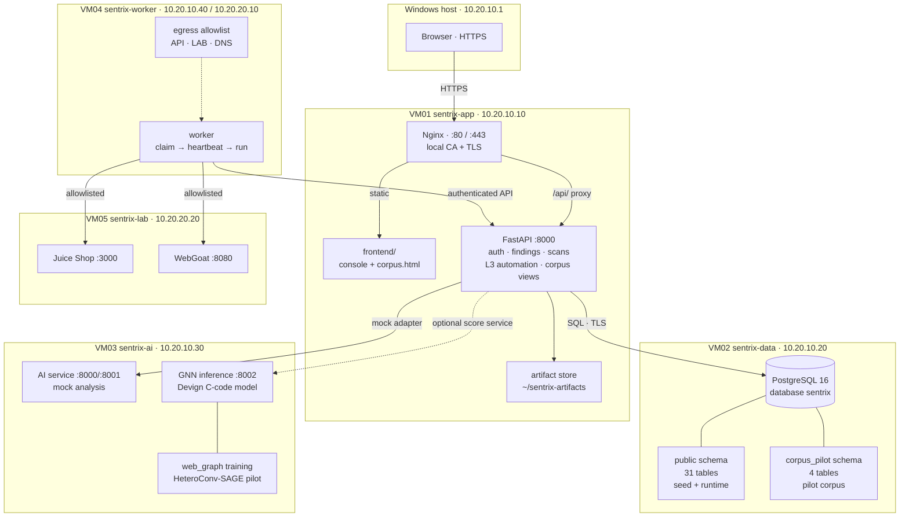
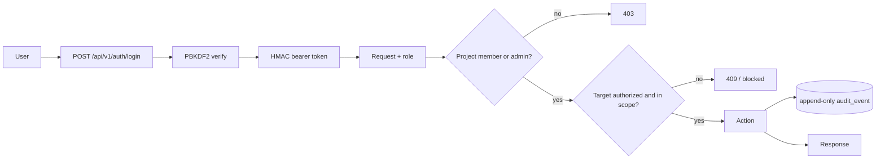
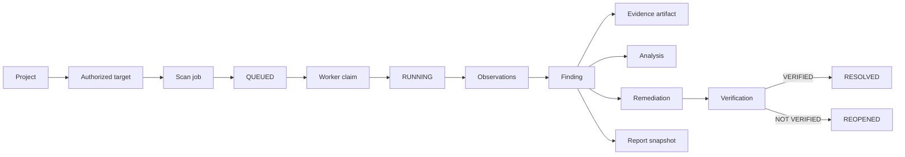
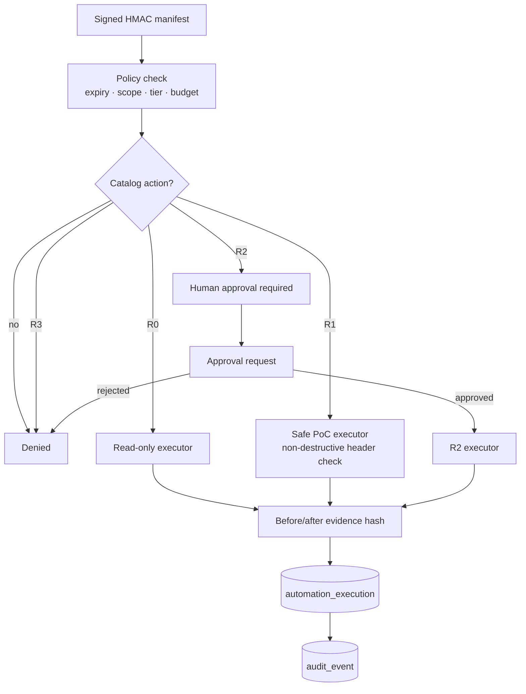
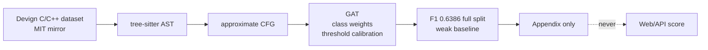
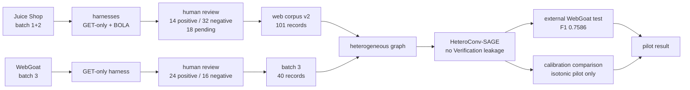
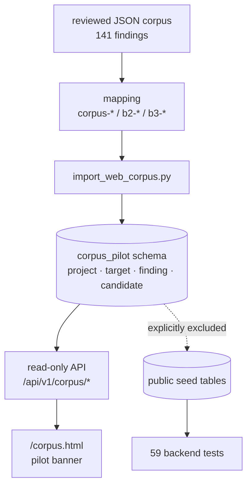

# SENTRIX — system flowchart

> As of 2026-10-26. This supersedes the earlier 26-table / Juice-Shop-only chart.

## 1. Lab topology

## 2. Request, auth and scope

Rules:

- project-scoped mutations require owner/member;
- admin-only routes cover automation policy and corpus pilot views;
- target authorization is recorded before a scan can be queued;
- audit/status history is append-only;
- corpus pilot routes are read-only and isolated.

## 3. Pentest workflow

Important: a remediation alone does not resolve a finding; verification does.

## 4. L3-C conditional automation

- R0: root-only read-only HTTP, no redirects, host allowlist.
- R1: non-destructive security-header validation.
- R2: approval workflow exists; state-changing execution is not implemented.
- R3: prohibited.
- Authorization remains human-signed.

## 5. GNN tracks

There are **two separate tracks**. They are not the same model.

### 5.1 Devign C-code experiment (appendix)

### 5.2 Web/API corpus pilot

Rules:

- training uses only HUMAN_VERIFIED / HUMAN_REJECTED labels; 18 records remain pending;
- `Verification` nodes/edges are excluded from training to prevent leakage;
- endpoint identity is an ablation that hurts; `no_endpoint` is better;
- Devign C-code scores are never applied to web findings;
- scores remain `pilot-uncalibrated`.

## 6. Corpus pilot import and UI

Isolation guarantees:

- public seed tables unchanged;
- corpus schema has `SELECT` only for `sentrix_app`;
- corpus API is admin-only and read-only;
- every response carries `pilot: true` and `pilot-uncalibrated`.

## 7. Milestones

```mermaid
flowchart LR
    M1[M1 schema + seed] --> M2[M2 auth/read API]
    M2 --> M3[M3 writes/audit]
    M3 --> M4[M4 adapter ports]
    M4 --> M5[M5 UI repository]
    M4 --> M6[M6 hardening/worker]
    M6 --> X1[X-01 approved local]
    X1 --> M5
    M5 --> M7[M7 experiments/ops]
    M7 --> L3[L3-C conditional automation]
    L3 --> GNN[web/API GNN pilot]
    GNN --> WG[WebGoat second lab]
    WG --> CORP[corpus project + pilot UI]
```

## 8. Component summary

| Component | Location | Responsibility |
|---|---|---|
| Nginx | VM01 | TLS termination, static UI, `/api/` proxy |
| FastAPI | VM01 `/backend/app` | auth, findings, scans, automation, corpus views |
| PostgreSQL | VM02 | 31 public tables + isolated `corpus_pilot` |
| Worker | VM04 | atomic job claim, heartbeat, scan execution |
| Juice Shop | VM05 :3000 | first lab target |
| WebGoat | VM05 :8080 | second lab target |
| AI service | VM03 | mock analyst support |
| GNN service | VM03 :8002 | Devign C-code inference only |
| Web GNN training | VM03 `~/sentrix-gnn` | HeteroConv-SAGE pilot |
| Corpus API | VM01 | read-only pilot data |

## 9. Honest boundaries

- The web GNN is a **pilot**, not production.\n- The current reviewed training set is 46 records (14 positive / 32 negative); 18 of 101 are still pending.
- External test is 40 records / 24 positives, dominated by header findings.
- Devign C-code model is weak and separate.
- Calibration is not production-validated.
- R2 state-changing execution is not implemented.
- Mobile and full IaC are explicitly out of scope.
