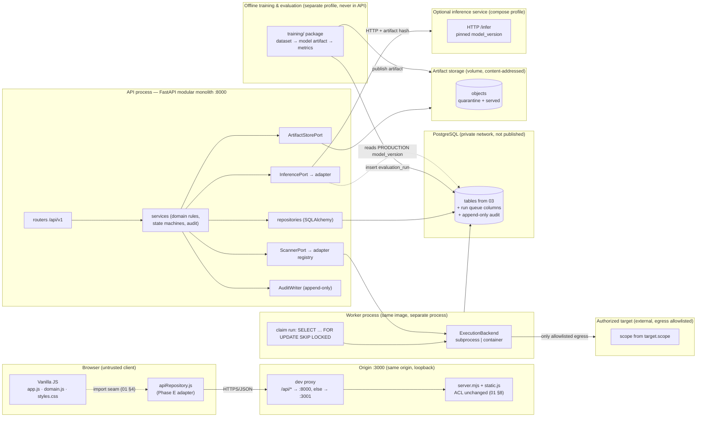

# SENTRIX — Phase 2 · Target Architecture, Adapters, Environment and Security Boundaries

| | |
|---|---|
| Status | Proposed target architecture. Nothing here is implemented; no existing file changes. |
| Inputs | [01 current state](01-current-state.md), [03 data model](03-data-model.md), [04 API](04-api-contract.md), [05 states](05-state-transitions.md) |
| Decisions | Options and recommendations are registered in [07](07-risks-assumptions-decisions.md). |

---

## 1. Design drivers

| Driver | Consequence |
|---|---|
| Frontend must keep working unchanged in Phase 2 | API is additive; the frontend's only seam (`domain.js`’s 14 methods) is mirrored by an HTTP adapter; display strings and messages are frozen (01 §7). |
| No off-origin requests in the browser check | API served under the same origin at `/api/v1` behind a dev proxy; no CORS. |
| “Current ACL must remain unchanged” | `server.mjs` / `static.js` stay byte-identical and keep serving the frontend; the API never serves static files or artifacts. |
| Authorized, evidence-bearing engagements | Every mutation is attributed to an actor with an attestation/audit trail; scan execution and AI inference are pluggable. |
| Graduation project: reproducible AI experiments | Model versions, dataset versions, evaluation runs and seeds are first-class records; training is offline and separate from online inference. |
| One developer, one host | Modular monolith + one worker + one PostgreSQL. No Kubernetes, no microservices, no message broker unless a requirement forces it. |
| Untrusted scanners/inputs | Scanner execution and artifact handling sit behind explicit isolation boundaries (explicitly not sandboxed by the API process). |

**Non-goals for Phase 2/3:** real vulnerability scanning, real model training, PDF rendering,
multi-tenancy, SSO, high availability, public exposure.

---

## 2. Target architecture



Trust boundaries are the dotted lines between subgraphs: browser, origin, API, worker,
database, artifact store, inference, target network. Each has its own controls in §7.

**Deployment units (all on one host in development):**

| Unit | Responsibility | Scale |
|---|---|---|
| Static origin (`server.mjs`, unchanged) | serve the 5 frontend assets under the existing ACL | 1 process |
| Dev proxy (new, Phase E) | same-origin `/api` routing only; forwards, never serves files | 1 process |
| `api` | HTTP contract, authorization, domain rules, orchestration, audit | 1–2 processes |
| `worker` | claim and execute scan runs and (optionally) inference jobs | 1–N processes |
| `db` | PostgreSQL, source of truth, append-only audit | 1 instance |
| `inference` (profile `inference`) | model server exposing a narrow `/infer` contract | optional |
| `training` (profile `training`) | offline training/evaluation, writes artifacts + evaluation rows | offline only |

---

## 3. Internal structure (modular monolith)

```
backend/
  app/
    main.py                 # FastAPI app factory, middleware (request-id, errors)
    config.py               # settings from env, no secrets in code
    db/                     # engine, session, migrations (alembic/)
    api/v1/                 # routers: projects, targets, scans, findings,
                            #          analyses, remediations, reports, models,
                            #          audit, auth, health
    schemas/                # Pydantic request/response models (wire contract)
    services/               # domain rules, state machines, authorization, audit
    repositories/           # SQL access, no business rules
    adapters/
      scanner/              # ScannerPort + demo adapter + future adapters
      inference/            # InferencePort + mock adapter + HTTP adapter
      storage/              # ArtifactStorePort + filesystem + S3-compatible
      execution/            # ExecutionBackend: subprocess | container
      audit.py              # AuditWriterPort
    workers/                # run_worker.py: claim → execute → normalize → persist
    alembic/                # migrations (demo seed is a script, not a migration)
  tests/                    # contract, state-machine, parity, security, isolation
inference/                  # optional model-serving container (compose profile)
training/                   # offline package + compose profile + notebooks (repo root)
scripts/dev-proxy.mjs       # same-origin /api routing for development (Phase E)

The dev proxy is a separate, tiny Node script (`scripts/dev-proxy.mjs`, Phase E) so the existing
static server stays untouched (02 §6).
```

**Dependency rule:** `api` and `services` may import `schemas`, `repositories`, and *ports*;
they must not import scanner/model/docker/HTTP-client implementations. Adapter implementations are
bound at startup from configuration. This is what makes requirement 6 (core domain independent of
scanner and model) testable: swap the adapter in a test and the service layer must not change.

---

## 4. Ports and adapters

### 4.1 Scanner port (requirement 6)

```python
# app/adapters/scanner/port.py  (design sketch, not implementation)
class ScannerPort(Protocol):
    code: str                                   # "demo", "nuclei", "zap", …
    def capabilities(self) -> ScannerCapabilities: ...
    def validate_request(self, req: ScanRequest) -> list[ValidationIssue]: ...
    def submit(self, req: ScanRequest, run: RunContext) -> SubmissionHandle: ...
    def poll(self, handle: SubmissionHandle) -> RunProgress: ...
    def cancel(self, handle: SubmissionHandle) -> None: ...
    def fetch_results(self, handle: SubmissionHandle) -> ScanResult: ...
```

Ports never receive the database session or ORM objects — only DTOs and a `RunContext`
(run id, attempt, target name/scope, profile config, artifact store handle, timeout, cancellation
token). The demo adapter replaces `runSimulatedScan` and must remain **deterministic**: same
target/profile/seed → same findings, including today's `Demo configuration exposure`/`Low`/`New`
result, so browser parity holds.

**Normalized result (adapter → domain):**

```
ScanResult:
  run_status: SUCCEEDED | FAILED | TIMED_OUT
  scanner: {code, version, config_hash}
  observations: [Observation]
  stats: {...}                 # counts, duration
Observation:
  fingerprint: str             # stable dedup key: rule_id + location + discriminator
  rule_id / category: str
  title: str
  severity_raw: str            # adapter's vocabulary, mapped by service to CRITICAL..LOW
  confidence: 0..1 | null
  location: JSONB              # host/path/param/line/container — adapter-specific schema
  evidence: [EvidenceItem]     # TEXT | HTTP_EXCHANGE | FILE | CONFIG_SNIPPET | LOG_EXCERPT
  raw: JSONB                   # bounded, redacted payload for traceability
```

Rules: parsers validate output against this shape; unknown/oversized/ill-typed payloads are
rejected and the run marked `FAILED` with a sanitized reason; `raw` is size-capped; the service
layer maps severity and dedups by `(project_id, dedup_key)`, where the adapter supplies the
fingerprint and the demo adapter folds the job id into it (03 M-03), before creating findings.
Scanner-created findings record their source run and observation; manual/demo findings may leave
`run_id`/`observation_id` null (03 §4.4).

**Adapter conformance suite** (must pass for any adapter):

1. `submit`→`poll`→`fetch_results` reaches exactly one terminal state;
2. cancellation before terminal state is honoured within the timeout;
3. results validate against the normalized schema; JSON round-trips;
4. identical input (fixture + seed) yields identical fingerprints (determinism);
5. oversized/slow/erroring adapter output is bounded and sanitized;
6. no adapter code path writes findings, evidence rows or audit directly — only the service does.

### 4.2 AI inference port (requirement 6, plus training separation)

```python
class InferencePort(Protocol):
    def model_version(self) -> ModelVersionRef: ...
    def analyze(self, req: AnalysisRequest) -> AnalysisResult: ...
    def health(self) -> InferenceHealth: ...

AnalysisRequest:  finding summary + severity + target context + evidence excerpts (redacted),
                  prompt_template_version_id (pinned), model_version_id (pinned),
                  timeout, simulated flag
AnalysisResult:   status, confidence (0..1), summary, limitations, latency_ms,
                  model_version_id, prompt_template_version_id, prompt_template_hash,
                  input_hash
```

- The **service** chooses a `model_version_id` from the registry (PRODUCTION stage) and pins it;
  an inference response that reports a different version is rejected (no silent model drift).
- The **service** also pins a `prompt_template_version_id` (active version of the configured
  template) and records it on the analysis; the adapter receives the version id, and the
  response's `prompt_template_hash` must equal the version's stored `content_hash` (I-11).
- `MockInferenceAdapter` preserves today's behaviour: confidence `0.91` for `CRITICAL`, `0.76`
  otherwise, deterministic summary/limitations, `simulated=true`. The API returns the 0–1 ratio; the
  adapter renders the current percent integer (91).
- `HttpInferenceAdapter` talks to the optional inference container: authenticated, bounded
  timeout (≤ the service timeout), retries only on transport errors and never across versions,
  circuit-breaker on repeated failures; failures become `analysis.status = FAILED` with a
  sanitized reason, not a fabricated analysis.
- **Training and evaluation are not API concerns.** `training/` exports a `dataset_version` through
  the read-only role, trains inside its own compose profile, writes an artifact + metrics, and
  records an `evaluation_run` through the narrow `sentrix_eval` role. Only `data_origin =
  MEASURED` rows count as experiment results; `SIMULATED` rows are demo placeholders and must be
  labelled as such by every consumer. Promotion to `PRODUCTION` is a human action that updates
  `model_version.stage`; the API only ever loads pinned artifacts. No notebook, dataset or
  training dependency is installed in the API image.

### 4.3 Other ports

| Port | Responsibility | Dev impl | Production-ready impl |
|---|---|---|---|
| `ArtifactStorePort` | content-addressed put/get/delete, quarantine vs served namespaces, sha256 verification | filesystem volume (`backend/var/artifacts`) | S3-compatible bucket, short-lived signed URLs |
| `ExecutionBackend` | run one scan process with limits and cancellation | subprocess with OS limits (no shell, argv arrays) | disposable container (non-root, read-only rootfs, caps dropped, no-new-privileges, egress allowlist) |
| `AuditWriterPort` | append one audit event inside the same transaction as the mutation | SQL insert, no update/delete privileges | same + optional hash chain |
| `Clock` / `IdGenerator` | testable time and opaque ids | UTC now / prefixed ULID | same |

---

## 5. Development environment (minimal, reproducible)

FastAPI + PostgreSQL + Docker Compose. Model training stays offline. Exact image tags are pinned
at implementation time (recommend digest pinning); the versions below are illustrative baselines.

```yaml
# docker-compose.yml (design sketch — not created yet)
services:
  db:
    image: postgres:17-alpine
    environment:
      POSTGRES_DB: sentrix
      POSTGRES_USER: sentrix_app
      POSTGRES_PASSWORD: ${POSTGRES_PASSWORD:?set in .env}
    volumes: [db-data:/var/lib/postgresql/data]
    ports: ["127.0.0.1:5432:5432"]        # loopback only
    healthcheck: { test: ["CMD-SHELL", "pg_isready -U sentrix_app -d sentrix"], interval: 5s }

  api:
    build: ./backend
    environment:
      DATABASE_URL: postgresql+psycopg://sentrix_app:${POSTGRES_PASSWORD}@db:5432/sentrix
      SENTRIX_ENV: development
      SENTRIX_SCANNER_ADAPTER: demo
      SENTRIX_INFERENCE_ADAPTER: mock     # or http + INFERENCE_URL
      SENTRIX_ARTIFACT_ROOT: /var/lib/sentrix/artifacts
    volumes: [artifacts:/var/lib/sentrix/artifacts]
    ports: ["127.0.0.1:8000:8000"]        # loopback only
    depends_on: { db: { condition: service_healthy } }

  worker:
    build: ./backend
    command: ["python", "-m", "app.workers.run_worker"]
    environment:
      DATABASE_URL: postgresql+psycopg://sentrix_app:${POSTGRES_PASSWORD}@db:5432/sentrix
      SENTRIX_ENV: development
      SENTRIX_SCANNER_ADAPTER: demo
      SENTRIX_INFERENCE_ADAPTER: mock
      SENTRIX_ARTIFACT_ROOT: /var/lib/sentrix/artifacts
    volumes: [artifacts:/var/lib/sentrix/artifacts]
    depends_on: { db: { condition: service_healthy } }
    # no published ports; no host mounts; resource limits set here

  inference:                              # optional profile
    profiles: ["inference"]
    build: ./inference
    ports: ["127.0.0.1:8100:8100"]        # API reaches it on the compose network

  training:                               # offline only, never started by default
    profiles: ["training"]
    build: ./training
    environment: { DATABASE_URL: postgresql+psycopg://sentrix_eval:... }   # eval/model rows only
    volumes: [artifacts:/var/lib/sentrix/artifacts]

volumes:
  db-data:
  artifacts:
```

**Developer commands (planned):**

```
cp .env.example .env
docker compose up -d db api worker
docker compose run --rm api alembic upgrade head
docker compose run --rm api python -m app.seed_demo        # loads the 01 §2 dataset
PORT=3001 npm run dev                                      # existing server, unchanged
node scripts/dev-proxy.mjs                                # :3000 → /api/:8000, else :3001
```

- The API image is built from `backend/`, not from the repository root; the frontend keeps its
  current no-build delivery.
- Training/evaluation tooling uses two DB roles: `sentrix_readonly` for dataset export (cannot
  mutate online state) and `sentrix_eval` with narrow INSERT/UPDATE rights on `evaluation_run` and
  model-version promotion rows only.
- Seed data is a script, not a migration: migrations create structure only; the demo seed can be
  re-applied to a scratch database for tests.
- `.env` is ignored; `.env.example` documents names only. No secret is committed.

---

## 6. Same-origin traffic path (browser-check compatibility)

The browser check asserts **every request is same-origin** (01 §1.2) and the ACL tests import
`server.mjs` directly. Therefore:

- `server.mjs`/`static.js` are **not modified**; the static origin keeps its ACL and keeps serving
  the current page.
- A new dev proxy, `scripts/dev-proxy.mjs`, listens on `:3000` (the URL the checks and README use)
  and routes:
  - `GET/HEAD/POST/… /api/v1/...` → `http://127.0.0.1:8000` (FastAPI),
  - every other path → `http://127.0.0.1:3001` (existing static server, `PORT=3001`).
- The proxy forwards method, headers, body, status and content-type; it sets
  `X-Forwarded-Proto`/`-Host`/`-For`; it never reads from disk, never serves a file itself and
  has no path handling of its own, so the static ACL remains defined by `server.mjs` alone.
- Because the page and API share an origin, there is **no CORS** and session cookies work without
  `SameSite=None`. CSRF protection is still required for cookie-authenticated mutations (§7).
- In production the same shape is provided by a real reverse proxy (TLS termination, rate limits);
  swapping the proxy does not change the API contract.

Consequence for Phase E: the adapter calls relative URLs (`/api/v1/...`), so nothing in the
frontend needs an origin setting, and the “no off-origin requests” assertion continues to pass.

---

## 7. Security boundaries (requirement 8)

### 7.1 Boundary map and controls

| # | Boundary | Threats | Controls (design) | Verification |
|---|---|---|---|---|
| B1 | Browser ↔ API | token theft, XSS-borne request forgery, replay, enumeration, privilege escalation via user/membership provisioning | session cookie `HttpOnly; Secure(prod); SameSite=Lax` + CSRF header for mutations; HTTPS in prod; opaque ids; 404 for unreadable resources; rate limits per user/IP; strict JSON schema; no HTML in any response; user/membership provisioning is ADMIN/OWNER-only with last-owner and last-admin guards | contract tests for 401/403/404; CSRF test; header/rate-limit tests; provisioning authz tests |
| B2 | API ↔ DB | injection, privilege escalation, audit tampering | parameterized SQL only; app role with no `DELETE`/`UPDATE` on audit tables and no DDL; migrations run as a separate role; least-privilege GRANTs | attempt `UPDATE audit_event` as app role → permission denied test |
| B3 | API ↔ worker | forged runs, duplicate execution, starvation | worker claims with `SELECT … FOR UPDATE SKIP LOCKED`, one active run per job (partial unique index), idempotent completion; worker is the only writer of run/observation/evidence results; no user input reaches shell | concurrency test: 2 workers, 1 run; duplicate-completion test |
| B4 | Worker ↔ target network | SSRF, DNS rebinding, port scanning outside scope, mass scanning | scanner requests derive **only** from an authorized target row; egress allowlist/proxy enforced at the container/network layer; resolved-IP re-check against allowlist at connect time (anti-rebinding); scope parsing and deny for link-local/metadata/loopback/RFC1918 unless explicitly authorized; rate limits; timeouts; no follow of redirects outside scope | egress-deny test; rebinding unit tests; scope-violation test |
| B5 | Worker ↔ artifacts | malicious files, path traversal, disk exhaustion, XSS via served content | content-addressed keys generated server-side; sha256 verified on read; size caps per artifact and per run; files never served inline from the API origin; downloads via `Content-Disposition: attachment` + `X-Content-Type-Options: nosniff` from an isolated path with auth; HTML/SVG/JS treated as opaque; viruses/archives quarantined and never auto-extracted | traversal tests; content-type tests; oversize test; sha mismatch test |
| B6 | Source-code uploads | zip-slip, decompression bombs, RCE by executing untrusted code, secret exfiltration, malware | **no upload feature exists today (A-02)** — when added: size/extension limits, encrypted quarantine bucket, extraction in a disposable no-network container with path traversal + bomb guards, no execution of uploaded code, per-project isolation, retention/erasure policy, never served from API origin, scan-before-use | upload fixture suite (zip-slip, bomb, polyglot); isolation test |
| B7 | Secrets | leakage via repo, images, logs, frontend | `.env` ignored, `.env.example` names only; Docker secrets/compose env for dev; API keys only in env, never returned by API or embedded in frontend; scanner/model credentials never flow to browser; key rotation; logs redact `Authorization`, cookies, tokens, target credentials | secret scan in CI; log-redaction tests |
| B8 | Audit | tampering, repudiation | append-only table with restricted grants; every mutation emits its documented audit set in the same transaction (one event per created/changed resource), including actor, action, resource type/id, outcome, request id, redacted metadata; authz denials logged; retention + export; optional hash chain for tamper-evidence | audit-event-set-per-endpoint test; tamper test; actor/request-id assertions |
| B9 | Static origin / ACL | serving hidden/ACL artifacts, escaping the root | **unchanged** (01 §8): GET/HEAD only, dot-segment denial incl. `.dsh-acl-recovery`, realpath containment for junctions/symlinks, 400/403/404/405 semantics | existing 17 static/server tests must keep passing byte-identically |
| B10 | Model supply chain | malicious model artifact, silent model drift, training in the request path | artifacts content-addressed + sha256 pinned by `model_version`; no `pickle`/unsafe deserialization from untrusted sources; inference container non-root, no network except DB/artifact reads; training never runs inside the API; analysis records the pinned version hash | artifact-hash mismatch test; drift test; image scan |
| B11 | Logs/telemetry | PII/secret leakage, log injection | structured JSON logs, request-id correlation, control-character sanitizing, evidence/target secrets redacted, no request bodies with credentials | log-redaction tests |
| B12 | Simulated-data integrity | demo/sample AI numbers presented as real experimental measurements | `evaluation_run.data_origin`, `model_version.is_mock`, `analysis.simulated` are NOT NULL/explicit; `/evaluations` always returns `dataOrigin`; the adapter formats sample metrics only for simulated sources; M7 accepts reproducibility only for `MEASURED` runs | AT-7.2, AT-7.7; seed manifest count 0 evaluation runs |

### 7.2 Source-code uploads — decision status

There is **no upload UI, endpoint or storage** in the current prototype, so this is a forward
design only. The plan deliberately keeps it out of Phase 3; if the graduation scope later requires
source-code review, it enters through the B6 controls above and a dedicated
`source_artifact` table/port, never as a free-text field on an existing entity. This is recorded
as open decision **D-16**.

### 7.3 Worker isolation — honest trade-off

Requirement 8 asks for worker isolation, and the plan keeps the execution backend behind a port so
the isolation level can grow without changing the domain:

1. **Baseline (M6):** worker in its own container with non-root user, read-only root filesystem,
   `cap_drop: ALL`, `no-new-privileges`, tmpfs `/tmp`, CPU/memory/pids limits, no host mounts, no
   published ports, and **no outbound network** for the demo adapter (it performs no I/O); scans
   run as subprocesses with argv arrays (never a shell), timeouts, output caps and cancellation
   via process group. A real scanner adapter adds the egress allowlist of §7.1 B4.
2. **Preferred:** one disposable container per run. This needs a container runtime control plane;
   mounting the Docker socket into the worker is **equivalent to root on the host** and is
   therefore rejected unless delegated to a dedicated rootless runner.
3. **Deliberately out of scope:** Kubernetes, VM-per-scan, network namespaces per scan.

Scanners themselves are not implemented in Phase 2/3 (the demo adapter is deterministic and
performs no network I/O), so B4/B5 controls are exercised by adapter conformance and isolation
tests until a real scanner adapter is added.

---

## 8. Cross-cutting behaviours

| Concern | Decision |
|---|---|
| Error format | One envelope `{"error":{"code","message","details","requestId"}}`; `message` reuses the frozen sentences in 01 §4.1 so toasts stay identical ([04](04-api-contract.md)). |
| Request correlation | `X-Request-Id` accepted or generated; stored on audit rows and returned in errors. |
| Idempotency | Mutating POSTs accept `Idempotency-Key`; server stores key+result hash for 24 h; replays return the original response. Analysis creation is idempotent by uniqueness as well (01 Q4). |
| Concurrency | Optimistic concurrency via `If-Match`/`updatedAt` on mutable resources (finding transitions, remediation status); stale write → `409 stale_resource`. |
| Pagination | Cursor (`limit`, `cursor`) on list endpoints; `GET /bootstrap` is explicitly a bounded demo projection (default cap 2,000 findings), documented in 04. |
| Auth | Session cookie (recommended, D-02; pending supervisor decision); demo user seeded so the UI needs no login screen in demo mode; role checks per 04 §6; user provisioning (ADMIN) and project membership management (OWNER) are part of M2/M3. |
| Simulated data | `evaluation_run.data_origin`, `model_version.is_mock` and `analysis.simulated` are explicit; `/evaluations` always returns `dataOrigin`; the seed has **zero** evaluation runs (06 §3.4, gate G8). |
| CORS | Disabled by design (same origin). |
| Time | UTC ISO-8601 with `Z` for timestamps; `YYYY-MM-DD` only where the current UI already uses dates (project `createdAt`, remediation `dueDate`). |
| Migrations | Alembic; forward-only in dev, `downgrade` tested for the last release; structure and seed are separate. |
| Backups/retention | `pg_dump` for dev; retention policy for audit and evidence is an open decision (07). |
| Observability | `/healthz` (process), `/readyz` (DB + adapter health), structured logs, run/analysis latency metrics; no third-party telemetry (mirrors current privacy stance). |

---

## 9. What is deliberately *not* introduced

| Rejected | Why |
|---|---|
| Kubernetes / service mesh | One host, one team, no HA/scale requirement; compose satisfies every acceptance test. |
| Microservices split | No independent scaling or team boundary; the modular monolith keeps one transaction for mutation+audit. |
| Redis/Celery/RabbitMQ | `SELECT … FOR UPDATE SKIP LOCKED` on `scan_run` gives the needed queue with one fewer stateful service; revisit only if throughput demands it (D-11). |
| TypeScript frontend rewrite | Constraint: no frontend changes in Phase 2; adapter is plain ES module. |
| Managed cloud services | Reproducibility and offline verification are explicit requirements. |
| Real scanners / trained models now | Adapter contracts and determinism are the Phase 2 deliverables; actual tools are a later phase with B4/B5 controls in place. |
