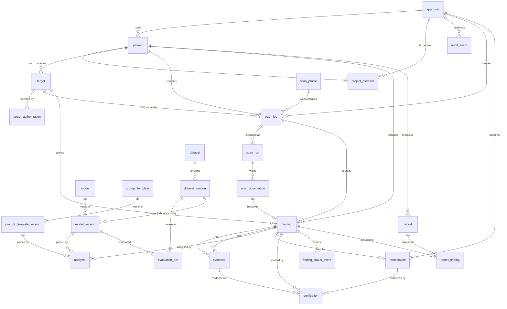

# SENTRIX — Phase 2 · ERD, Schema and Data Dictionary

| | |
|---|---|
| Status | Proposed data model. DDL lives in [schema.sql](../../database/schema.sql); it is a design artifact and has not been applied (no PostgreSQL in this environment). |
| Inputs | [01 current state](01-current-state.md) field inventory; [05 state transitions](05-state-transitions.md); [04 API](04-api-contract.md) |
| Parity rule | The API returns canonical codes; the frontend adapter maps them to the **current display strings** (table in §3). Field names in the compatibility projection mirror 01 §2. |

---

## 1. Entity-relationship diagram

Reading order: identity (`app_user`, `project*`) → scope (`target*`, `scan_profile`) →
execution (`scan_job`, `scan_run`, `scan_observation`) → results (`finding`, `evidence`) →
intelligence (`model*`, `prompt_template*`, `dataset*`, `evaluation_run`, `analysis`) → response
(`remediation`, `verification`) → reporting/audit (`report*`, `finding_status_event`,
`audit_event`).

---

## 2. Structural decisions and why

| Decision | Why | Current-state trigger |
|---|---|---|
| **Split `scans` into `scan_job` + `scan_run`** | A job is the user's configured assessment; a run is one execution attempt with its own status, worker, attempt number, timestamps, exit code and stats. Retries must not overwrite the only history row. | 01 §2.3: one mutable row, `Running` unreachable, no attempts |
| **`scan_observation` between run and finding** | Adapters return normalized observations (rule, location, fingerprint, bounded raw payload), not findings. Dedup and severity mapping belong to the service layer; findings can also be manual. | 01 §4 `runSimulatedScan` fabricates a finding directly |
| **Evidence becomes rows + artifacts** | Today evidence is one text field. Real evidence has kind, content or artifact reference, hash, source run and capture time; it must stay attached to the finding it supports. | 01 §2.4 `finding.evidence: string` |
| **`verification` is a separate immutable record** | Requirement: a finding must not become verified/resolved because a task was created or closed. Verification has method, outcome, verifier, evidence/notes and timestamp; the finding transition references the verification id. | 01 §4 row 11: verification is a scalar on the task, set in the same call that resolves the finding |
| **`finding_status_event` history** | Every transition is attributable and explainable, including automated ones; the `verification_id` column makes “RESOLVED without verification” detectable in SQL. | 01 §4.8: arbitrary status assignment, no history |
| **Remediation status ≠ finding status** | A task can be completed while the finding awaits verification, and a verification can be requested without a task. | 01 §4 row 11 conflation (Q3) |
| **Report snapshot (`report_finding`)** | Exports must be reproducible after findings change. The live `projectId`-only CSV in `domain.js` cannot reproduce a published report. | 01 §2.7/§5.1 (Q5, Q6) |
| **Model registry + dataset versions + evaluation runs** | Reproducible AI experiments require pinned model artifacts, dataset content hashes, seeds, environment and metrics; analyses reference a `model_version`. An `evaluation_run` also carries `data_origin` so a simulated run can never be read as a measurement. | 01 §2.9: display strings, no artifacts or datasets |
| **Prompt templates are versioned and pinned** | An analysis must be explainable and reproducible: the exact template version (content + hash) is stored, not a free-text hash. Template versions are immutable. | 01 §2.5: hard-coded model/version, no prompt record |
| **Simulated vs measured data is a first-class distinction** | `model_version.is_mock`, `analysis.simulated` and `evaluation_run.data_origin` keep demo numbers visibly separate from experimental measurements; the API/UI label them. | 01 §2.9: `"Sample …"` display strings |
| **`target_authorization` attestation** | The authorization checkbox must survive as evidence of who authorized what, when, with which scope. `authorized`/`status` are derived from it rather than stored twice. | 01 §4.4: checkbox only, not stored |
| **Append-only audit with actor + request id + typed resource** | Current audit is an in-memory array with a hard-coded actor and human-readable resource name. | 01 §2.8 (Q10) |
| **Canonical enum codes** | The domain must not depend on presentation. The adapter maps codes to today's strings, so the UI does not change. | 01 §2/§7 |
| Opaque text ids | Today's ids are `prefix + 6 base36`. The backend needs collision-resistant, non-enumerable ids; the demo seed may keep readable ids for parity. | 01 §9 (Q11) |

---

## 3. Enum ↔ current display-string mapping (adapter contract)

| DB enum | Code | Frontend string today | Notes |
|---|---|---|---|
| `project_status` | `ACTIVE` / `ARCHIVED` | `Active` / `Archived` | |
| `target_type` | `WEB` / `API` / `CLOUD` | `Web` / `API` / `Cloud` | `Cloud` only in the form today |
| target state (derived) | attestation present → `MONITORED`; absent → `BLOCKED` | `Monitored` / `Blocked` | `authorized` boolean = attestation present |
| `scan_job_status` | `QUEUED` / `RUNNING` / `COMPLETED` / `FAILED` / `CANCELLED` | `Queued` / `Running` / `Completed` / `Failed` / `Cancelled` | UI has no `Draft` row; treat 01's lifecycle caption as copy (D-05) |
| `scan_run_status` | `PENDING`/`RUNNING`/`SUCCEEDED`/`FAILED`/`TIMED_OUT`/`CANCELLED` | not exposed as a separate UI entity | job status is the projection |
| `finding_severity` | `CRITICAL`/`HIGH`/`MEDIUM`/`LOW` | `Critical`/`High`/`Medium`/`Low` | |
| `finding_status` | `NEW`/`CONFIRMED`/`IN_PROGRESS`/`RESOLVED`/`REOPENED`/`ACCEPTED_RISK`/`FALSE_POSITIVE` | `New`/`Confirmed`/`In Progress`/`Resolved`/`Reopened`/`Accepted Risk`/`False Positive` | `False Positive` is referenced by the dashboard but unreachable in the UI |
| `analysis_status` | `QUEUED`/`RUNNING`/`COMPLETED`/`FAILED` | `Queued`/`Running`/`Completed`/`Failed` | today only `Completed` exists |
| `remediation_status` | `IN_PROGRESS`/`COMPLETED`/`REOPENED`/`CANCELLED` | `In Progress`/`Completed`/`Reopened`/`Cancelled` | |
| `verification_outcome` | `VERIFIED`/`REJECTED` | UI sends `Verified`; the old code treated everything else as failure | wire value for the demo adapter: `Verified` |
| `verification_method` | `RESCAN`/`AUTOMATED_TEST`/`MANUAL_REVIEW` | — | new concept |
| `report_status` | `DRAFT`/`PUBLISHED` | `Draft`/`Published` | |
| `evaluation_data_origin` | `SIMULATED`/`MEASURED` | not shown today; adapter formats sample metrics only when `SIMULATED` | never rendered as a measurement |
| `model_stage` | `CANDIDATE`/`STAGED`/`PRODUCTION`/`ARCHIVED` | `Production` (only value shown) | |
| `audit_outcome` | `SUCCESS`/`SIMULATED`/`DENIED`/`FAILURE` | `Success`/`Simulated` (observed) | |

The adapter in [06 §5](06-migration-and-acceptance.md#5-frontend-adapter-and-traffic-path) owns this
table; outside the legacy `/bootstrap` projection (04 §1.3, §4.12) the API returns codes only, and
the UI never sees codes.

---

## 4. Data dictionary

Types/constraints are authoritative in [schema.sql](../../database/schema.sql); this section documents meaning,
nullability and the current-state field each column replaces. “—” means a new field with no
current equivalent.

### 4.1 Identity and tenancy

**`app_user`** — new; the UI hard-codes people as strings (01 A-04).

| Column | Null | Meaning / source |
|---|---|---|
| `id` | no | opaque user id |
| `display_name` | no | replaces free-text `owner`, `assignee`, `actor` names |
| `email` | no | unique case-insensitively; identity for sessions/IdP |
| `role` | no | platform role: `ADMIN`/`ANALYST`/`VIEWER` (04 §6) |
| `password_hash` | yes | null when an external IdP is used (D-02) |
| `is_active` | no | deactivation instead of deletion |
| `created_at` | no | — |

**`project`** — replaces `projects` (01 §2.1).

| Column | Null | Meaning / source |
|---|---|---|
| `id` | no | opaque; demo seed keeps `project-atlas` ids |
| `name` | no | required, display name, unique case-insensitively (current rule) |
| `owner_id` | no | replaces `owner` string; UI default “Maya Chen” → seeded user |
| `scope` | no | declared engagement scope; default `Not configured` matches `domain.js:64` |
| `status` | no | `ACTIVE`/`ARCHIVED`; archive is one-way today |
| `created_on` | no | date only — keeps `createdAt: "2026-10-12"` wire format |
| `created_at` | no | full timestamp for ordering/audit |
| `updated_at` | no | app-managed; optimistic concurrency (`If-Match`) |
| `archived_at` | yes | when archive happened |

**`project_member`** — new; project-scoped authorization.

| Column | Null | Meaning |
|---|---|---|
| `project_id`, `user_id` | no | membership pair (PK) |
| `role` | no | `OWNER`/`ANALYST`/`VIEWER` within the project |
| `created_at` | no | when the grant was created |

### 4.2 Scope: targets and profiles

**`target`** — replaces `targets` (01 §2.2).

| Column | Null | Meaning / source |
|---|---|---|
| `id`, `project_id` | no | project scoping; composite unique enables FK integrity |
| `name` | no | hostname/URL as entered, unparsed (as today) |
| `type` | no | `WEB`/`API`/`CLOUD`; default `WEB` matches the form |
| `scope` | no | authorized scope string; may be empty only for a blocked target |
| `created_at`, `created_by` | no | — (targets currently have no timestamps) |
| `updated_at` | no | app-managed; used by future revocation flow |
| *(derived)* `authorized` | — | `EXISTS(active target_authorization)` |
| *(derived)* `status` | — | `MONITORED` when authorized, else `BLOCKED` |

**`target_authorization`** — new; replaces the checkbox in `app.js:58`.

| Column | Null | Meaning |
|---|---|---|
| `id`, `target_id` | no | one active attestation per target (partial unique) |
| `attested_by` | no | user who ticked the attestation |
| `attested_at` | no | when |
| `statement` | no | exact text attested, e.g. the form sentence |
| `scope_snapshot` | no | scope as it was at attestation time |
| `revoked_at` | yes | revocation without deletion (no UI yet) |

**`scan_profile`** — replaces the free-text `profile` (01 §2.3).

| Column | Null | Meaning |
|---|---|---|
| `id` | no | stable profile key (`external_attack_surface`, …) |
| `name` | no | display label used by the UI (`External attack surface`) |
| `adapter_code` | no | which scanner adapter implements the profile |
| `config` | no | adapter configuration (bounded JSON) |
| `is_active` | no | allow retiring a profile without deleting history |

### 4.3 Execution

**`scan_job`** — replaces `scans` (01 §2.3).

| Column | Null | Meaning / source |
|---|---|---|
| `id` | no | opaque; demo/compat ids may keep `scan-…` shape |
| `project_id` | no | from the target, as today (`domain.js:82`) |
| `target_id` | no | must belong to `project_id` (composite FK) |
| `name` | no | required display name |
| `profile_id` | no | replaces `profile` string |
| `status` | no | `QUEUED`/`RUNNING`/`COMPLETED`/`FAILED`/`CANCELLED` (05 §2) |
| `created_at`, `created_by` | no | — |
| `cancelled_at`, `failure_reason` | yes | — |
| *(derived)* `progress` | — | latest run progress (100 when completed, 0 when queued) |
| *(derived)* `completedAt` | — | latest successful run's `finished_at` |

**`scan_run`** — new; replaces the implicit “one execution”.

| Column | Null | Meaning |
|---|---|---|
| `id`, `job_id`, `attempt` | no | attempts are 1..n, unique per job |
| `status` | no | run-level state (05 §2); at most one `PENDING`/`RUNNING` per job |
| `progress` | no | 0–100, written by the worker heartbeat |
| `adapter_code` | no | which adapter executed it |
| `worker_id`, `started_at`, `finished_at`, `heartbeat_at` | yes | execution identity and timing |
| `exit_code`, `error_message`, `stats` | yes | sanitized outcome, bounded stats |
| `created_at` | no | enqueue time |

**`scan_observation`** — new; adapter output before it becomes a finding.

| Column | Null | Meaning |
|---|---|---|
| `id`, `run_id`, `fingerprint` | no | fingerprint is the dedup key within a run |
| `scanner_code`, `rule_id`, `title`, `severity_raw` | mostly | adapter vocabulary; mapped by the service |
| `confidence` | yes | adapter confidence 0–1 if provided |
| `location` | no | adapter-specific location JSON (host/path/param/line) |
| `payload` | no | bounded, redacted raw output for traceability |
| `created_at` | no | — |

### 4.4 Results

**`finding`** — replaces `findings` (01 §2.4).

| Column | Null | Meaning / source |
|---|---|---|
| `id` | no | opaque |
| `project_id`, `target_id` | no | composite FK guarantees they agree |
| `job_id`, `run_id` | yes | source job/run; `run_id` survives job deletion (`SET NULL`) |
| `observation_id` | yes | the observation that produced it (unique) |
| `dedup_key` | yes | project-scoped fingerprint; partial unique prevents duplicates |
| `title` | no | free text |
| `severity` | no | enum (04 validation) |
| `status` | no | enum (05 §4) |
| `notes` | no | analyst notes (current field) |
| `source` | no | `SCANNER`/`MANUAL`/`DEMO` |
| `created_at`, `updated_at`, `resolved_at` | timestamps | `resolved_at` set only with a verification |
| `created_by` | yes | null for scanner-created rows (actor is the system) |
| *(derived)* `evidence` | — | API compatibility field: primary inline evidence text or rendered summary (04 §4.5) |

**`finding_status_event`** — new; replaces “whatever the last mutation did”.

| Column | Null | Meaning |
|---|---|---|
| `id`, `finding_id` | no | |
| `from_status` | yes | null for creation |
| `to_status` | no | target status |
| `actor_id` | yes | user, or null for scanner/demo-system transitions; seed backfills use the seeded `user-system` account |
| `reason` | no | required for risk acceptance, false positive, manual reopen (04 §5) |
| `verification_id` | yes | required when `to_status = RESOLVED` |
| `occurred_at` | no | |

**`evidence`** — replaces `finding.evidence: string` (01 §2.4).

| Column | Null | Meaning |
|---|---|---|
| `id`, `finding_id` | no | evidence belongs to exactly one finding |
| `run_id` | yes | capture provenance |
| `kind` | no | `TEXT`/`HTTP_EXCHANGE`/`FILE`/`SCREENSHOT`/`CONFIG_SNIPPET`/`LOG_EXCERPT` |
| `title` | no | short label |
| `content` | yes* | inline redacted excerpt; at least one of content/storage_uri must exist |
| `storage_uri` | yes* | content-addressed artifact key (never a client path) |
| `sha256`, `size_bytes`, `mime_type` | yes | artifact integrity/metadata |
| `captured_at`, `created_at`, `created_by` | — | when captured/recorded and by whom |

### 4.5 Intelligence

**`model`** — replaces `models[].name`/`.status` (01 §2.9).

| Column | Null | Meaning |
|---|---|---|
| `id`, `name`, `provider_type` | no | provider type `MOCK`/`HTTP`/… |
| `description`, `created_at` | — | |

**`model_version`** — replaces the version/metrics display strings.

| Column | Null | Meaning |
|---|---|---|
| `id`, `model_id`, `version` | no | unique per model |
| `stage` | no | `CANDIDATE`/`STAGED`/`PRODUCTION`/`ARCHIVED`; one production per model |
| `artifact_uri`, `artifact_sha256` | yes | pinned artifact; hash verified before use |
| `training_dataset_version_id` | yes | reproducibility link |
| `metrics` | no | structured evaluation metrics; for `is_mock=true` these are **sample values** and must never be presented as measurements (04 §4.12) |
| `is_mock` | no | demo/mock analyses must be distinguishable forever |
| `created_at`, `promoted_at` | — | |

**`dataset` / `dataset_version`** — replace `datasets` display rows.

| Table | Key columns | Meaning |
|---|---|---|
| `dataset` | `id`, `name`, `description`, `provenance`, `license`, `created_at` | dataset identity and governance; `provenance` mirrors today's sample string, `license` is required for reproducible experiments; the actual dataset/licence choice is decision X-03 (pending) |
| `dataset_version` | `id`, `dataset_id`, `version`, `sample_count`, `label_distribution`, `content_hash`, `created_at`, `created_by` | immutable snapshot; `content_hash` anchors reproducible runs; `label_distribution` replaces the `labels` display string |

**`evaluation_run`** — new.

| Column | Null | Meaning |
|---|---|---|
| `id`, `model_version_id`, `dataset_version_id` | no | what was evaluated against what |
| `status` | no | `RUNNING`/`COMPLETED`/`FAILED` |
| `data_origin` | no | `SIMULATED` (seed/demo) or `MEASURED` (real experiment); `MEASURED` requires a seed, `finished_at` and non-empty metrics (CHECK) |
| `metrics` | no | precision/recall/F1/latency etc., structured |
| `environment`, `seed` | no/yes | image digest, hardware, RNG seed — reproducibility |
| `started_at`, `finished_at`, `created_by` | — | |

**`prompt_template` / `prompt_template_version`** — new; replaces the free-text
`analysis.prompt_template_hash`.

| Table | Key columns | Meaning |
|---|---|---|
| `prompt_template` | `id`, `name`, `purpose`, `is_active`, `created_at` | named template family (e.g. “finding risk assessment”) |
| `prompt_template_version` | `id`, `template_id`, `version`, `content`, `content_hash`, `created_at`, `created_by` | immutable body + sha256; `UNIQUE(template_id, version)`; append-only (trigger); no secrets in `content` |

**`analysis`** — replaces `analyses` (01 §2.5).

| Column | Null | Meaning / source |
|---|---|---|
| `id`, `finding_id` | no | one live analysis per finding (partial unique) |
| `model_version_id` | no | replaces hard-coded `model`/`version` strings |
| `prompt_template_version_id` | no | exact template version used; API exposes its `content_hash` as `promptTemplateHash` |
| `status` | no | `QUEUED`/`RUNNING`/`COMPLETED`/`FAILED` |
| `confidence` | yes | 0–1 in DB; the adapter renders today's integer percent (91) |
| `summary`, `limitations` | yes | model output / disclaimers |
| `input_hash` | yes | hash of the redacted input actually sent to inference |
| `latency_ms` | yes | replaces `"Sample 420 ms"` |
| `simulated` | no | true for mock analyses (today always true) |
| `failure_reason` | yes | sanitized |
| `created_at`, `completed_at` | — | |

### 4.6 Response and reporting

**`remediation`** — replaces `remediations` (01 §2.6).

| Column | Null | Meaning / source |
|---|---|---|
| `id`, `finding_id` | no | one or more tasks per finding (UI shows one) |
| `assignee_id` | no | replaces free-text `assignee` (resolved through the demo user) |
| `due_date` | yes | date-only, matching `"2026-10-24"` |
| `status` | no | `IN_PROGRESS`/`COMPLETED`/`REOPENED`/`CANCELLED`; **closing does not resolve the finding** |
| `notes` | no | |
| `created_at`, `created_by`, `updated_at`, `closed_at`, `reopened_at` | — | — |
| *(removed)* `verification` scalar | — | replaced by `verification` rows |

**`verification`** — replaces `remediation.verification` (01 Q3).

| Column | Null | Meaning |
|---|---|---|
| `id`, `finding_id` | no | the finding being verified |
| `remediation_id` | yes | task this verification closes/assesses (nullable when verification is independent) |
| `outcome` | no | `VERIFIED`/`REJECTED` |
| `method` | no | `RESCAN`/`AUTOMATED_TEST`/`MANUAL_REVIEW` |
| `verifier_id` | no | accountable human, or the seeded `user-system` account for migration backfills |
| `evidence_id` | yes* | appended evidence supporting the outcome |
| `notes` | no* | required if no evidence row |
| `verified_at`, `created_at` | no | |

**`report` / `report_finding`** — replace `reports` (01 §2.7).

| Table | Key columns | Meaning |
|---|---|---|
| `report` | `id`, `project_id`, `job_id`, `title`, `status`, `snapshot_hash`, `created_at`, `created_by`, `published_at` | title defaults to `` `<project> — Security assessment` ``; `job_id` is stored for provenance (the CSV filter ambiguity is resolved in 04 §4.11) |
| `report_finding` | `report_id`, `finding_id`, `position`, `severity`, `status`, `title`, `target_name`, `evidence_excerpt` | immutable rows captured at generation; `position` (1..n) freezes the export order (finding `created_at DESC` at generation time), reproducing today's CSV layout and content even after findings change |

**`audit_event`** — replaces `audit` (01 §2.8).

| Column | Null | Meaning / source |
|---|---|---|
| `id`, `occurred_at` | no | replaces `id`/`at` |
| `actor_id`, `actor_label` | yes/no | replaces hard-coded `actor`; label is denormalized |
| `action` | no | stable verb (`project.created`, `finding.transitioned`, …) rather than prose |
| `resource_type`, `resource_id`, `resource_name` | no/yes/no | replaces the single human-readable `resource` string |
| `outcome` | no | `SUCCESS`/`SIMULATED`/`DENIED`/`FAILURE` |
| `request_id` | yes | correlation |
| `metadata` | no | redacted details (old→new status, reason codes, idempotency key); never evidence bodies or secrets |

---

## 5. Current field → new home

| Current field (`domain.js`) | New location | Change |
|---|---|---|
| `projects[].owner` | `project.owner_id` → `app_user.display_name` | name becomes a reference |
| `targets[].authorized` / `.status` | derived from `target_authorization` | single source of truth |
| `scans[].profile` | `scan_job.profile_id` → `scan_profile.name` | free text → reference |
| `scans[].progress` | `scan_run.progress` (job projection) | real progress, not just 0/100 |
| `scans[].simulated` | `analysis.simulated`, `finding.source='DEMO'`, `scan_job.profile`/adapter | split by meaning |
| `findings[].evidence` | `evidence.content` (primary TEXT row) | string → rows; API compatibility field kept |
| `findings[].scanId` | `finding.job_id` | renamed to match job/run split |
| `analyses[].model/.version` | `analysis.model_version_id` → `model`/`model_version` | registry instead of strings |
| `analyses[].confidence` (91) | `analysis.confidence` (0.91) | DB stores ratio; adapter renders percent |
| `remediations[].assignee` | `remediation.assignee_id` | name → user |
| `remediations[].verification` | `verification.outcome` (+ method/evidence/verifier) | scalar → immutable record |
| `reports[].scanId` | `report.job_id` | now validated and FK-enforced |
| `models[].precision…inference` strings | `model_version.metrics` / `evaluation_run.metrics` + `latency_ms` | display strings → structured metrics (adapter formats for the UI) |
| `datasets[].samples/.labels` | `dataset_version.sample_count`/`label_distribution` | strings/numbers → structured |
| `audit[].actor/.resource/.outcome` | `audit_event.actor_*`, `resource_*`, `outcome` | typed, attributable, correlated |

---

## 6. Constraint and invariant catalogue

Database-enforced:

| Id | Invariant | Mechanism |
|---|---|---|
| C-01 | Project names are unique case-insensitively | `project_name_lower_uq` |
| C-02 | A target belongs to exactly one project; a job/finding cannot reference a target from another project | composite `(id, project_id)` unique + composite FKs |
| C-03 | A finding's job belongs to the same project | `finding_job_same_project` |
| C-04 | A target has at most one active authorization attestation | `target_authorization_active_uq` |
| C-05 | A job has at most one active run | `scan_run_one_active_uq` |
| C-06 | Run attempts are unique per job | `scan_run (job_id, attempt)` |
| C-07 | A finding has at most one live analysis | `analysis_live_uq` |
| C-08 | Scanner findings cannot duplicate within a project | `finding_dedup_uq` |
| C-09 | One observation produces at most one finding | `finding.observation_id UNIQUE` |
| C-10 | Confidence is a 0–1 ratio | `CHECK` on analysis/observation |
| C-11 | Evidence has inline content or an artifact reference | `evidence_has_content` |
| C-12 | Verification has evidence or a note | `verification_evidence_or_note` |
| C-13 | One production model version per model | `model_version_one_production_uq` |
| C-14 | Audit, status history and prompt-template versions are append-only | DB triggers + revoked UPDATE/DELETE grants (M6) |
| C-15 | Evidence and report snapshots are immutable through the API | no UPDATE grant; FK cascades still permitted for retention/erasure (D-14) |
| C-16 | A prompt-template version is immutable and unique per template | append-only trigger; `UNIQUE(template_id, version)`; content hash CHECK |
| C-17 | A `MEASURED` evaluation run has a seed, `finished_at` and non-empty metrics | `evaluation_measured_requires_evidence` CHECK |
| C-18 | Simulated evaluation data is explicitly marked | `evaluation_run.data_origin` NOT NULL, default `SIMULATED`; API must expose it (04 §4.12) |

Service-enforced (tested in [06 §6](06-migration-and-acceptance.md#6-milestones-and-acceptance-tests), SQL-checkable where noted):

| Id | Invariant | Enforced in |
|---|---|---|
| I-01 | `RESOLVED` only from `IN_PROGRESS` or `REOPENED`, and only through a `VERIFIED` verification (never via the generic transition endpoint) | transition service; `finding_status_event.verification_id` makes violations detectable in SQL |
| I-02 | Closing a remediation (`COMPLETED`) never changes `finding.status` | service (05 §3.1) |
| I-03 | `REJECTED` verification reopens: task `REOPENED`, finding `REOPENED` | service |
| I-04 | `ACCEPTED_RISK`/`FALSE_POSITIVE`/manual `REOPENED` require a reason | request schema |
| I-05 | `RESOLVED`/`ACCEPTED_RISK`/`FALSE_POSITIVE` findings cannot receive new remediation work without an explicit reopen | service (409) |
| I-06 | A job cannot start unless its target is authorized, scoped, and the project is active | service (matches today's guards) |
| I-07 | Archived projects accept no new targets/scans/reports | service (409) |
| I-08 | Every mutation writes audit events in the same transaction: one per created/changed resource; the expected event set per endpoint is specified in 04 §4/§8 and asserted in tests | service + audit tests |
| I-09 | `analysis.confidence` only written by the service from the adapter result; the model version recorded equals the version requested | service |
| I-10 | Deleting a project is not exposed; archive is the only state change | API surface |
| I-11 | An analysis pins a `prompt_template_version_id` and its persisted `content_hash` equals the template content; a mock analysis stores `simulated=true` and references a mock (`is_mock`) model version | service + FK/trigger + AT-4.7 |
| I-12 | `evaluation_run.data_origin='SIMULATED'` rows are never returned as measurements: API responses always include `dataOrigin`, and only `MEASURED` runs may feed experiment tables/claims | service + API + AT-7.7 |
| I-13 | `scan_job.updated_at` and `target.updated_at` change with every state-changing write, so `If-Match` is meaningful for job/target mutations | service + AT-3.18 |

---

## 7. Deliberately not modelled (yet)

| Not modelled | Reason |
|---|---|
| Tenant/organization table | single-tenant demo assumption (A-03); project membership is enough |
| Source-code artifacts/uploads | no such feature exists today (A-02, D-16) |
| Scan schedules/continuous monitoring | UI shows a “Monitored” target status but no scheduling exists |
| Notification/subscription tables | Settings buttons are disabled and have no behaviour |
| PDF report content | export is CSV only today (`README.md:73`) |
| Comments/attachments on findings | not present in the UI |
| Soft-deleted rows | no delete UI; retention is a policy decision (D-14) |

## 8. Open modelling questions

| # | Question | Current assumption |
|---|---|---|
| M-01 | Is one analysis per finding really the rule, or should history be kept? | one live analysis, previous completed ones retained only if a retry was needed (C-07) |
| M-02 | Does verification require uploaded evidence, or is a note enough? | either, C-12; tighten in D-08 |
| M-03 | Should findings dedupe across runs (real scanners) while the demo dedupes per job? | yes: real adapters use `project_id + fingerprint`; the demo adapter folds the job id into the fingerprint to preserve 01 §4 row 6 behaviour |
| M-04 | Do we need `DRAFT` scan jobs? | no (D-05); the UI caption is copy |
| M-05 | Should report snapshots be versioned (re-generate → new report) or mutated? | new report row; published reports immutable (scope decision D-09) |
| M-06 | Retention/erasure for evidence and audits | unresolved (D-14) |
| M-07 | Where do prompt templates come from — code default or admin-managed? | code/seeded default in MVP; admin editing is deferred future work (04 P-08) |
| M-08 | Does the demo seed include an evaluation run? | no: seed has `evaluation_run` count 0; simulated demo metrics live only on `model_version.metrics` with `is_mock=true`; the first run is a real `MEASURED` one in M7 (06 §3.4) |
