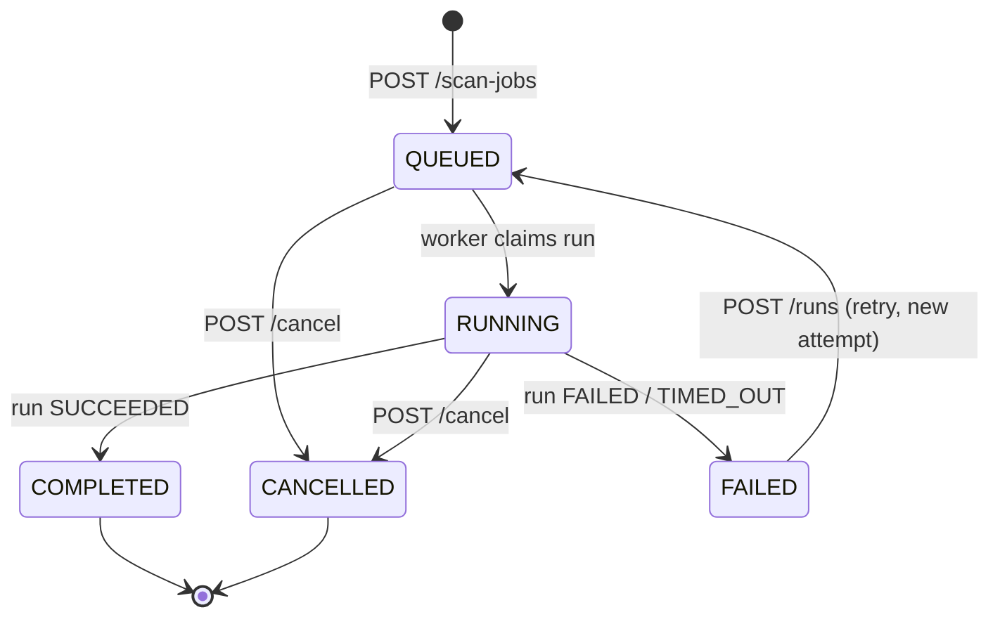
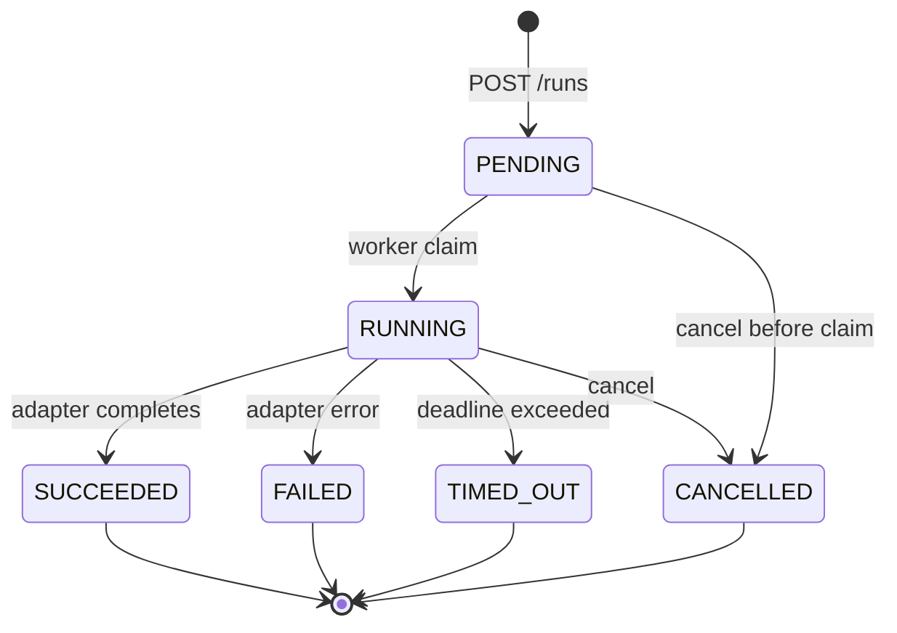
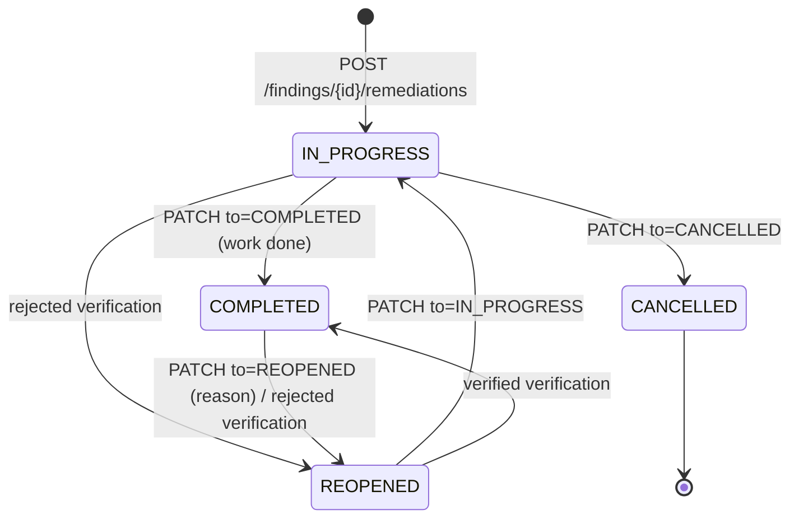
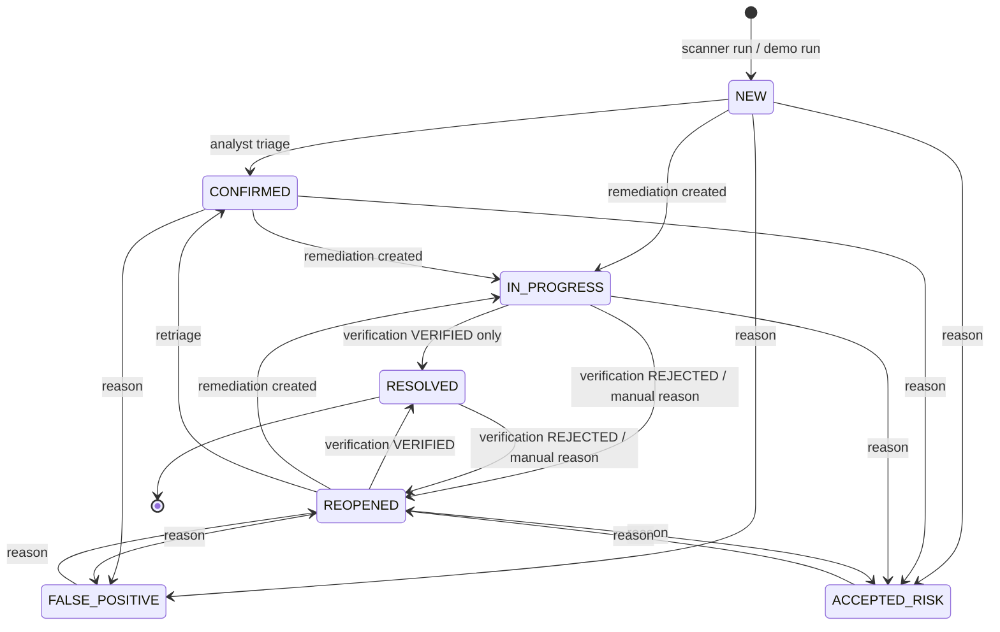

# SENTRIX — Phase 2 · Domain State-Transition Specification

| | |
|---|---|
| Status | Proposed specification. Not implemented; no existing file changed. |
| Scope | Scan jobs/runs, findings, remediation, verification, plus the smaller machines (project, target, analysis, report). |
| Hard rule from the brief | **A finding must not become verified/resolved merely because a remediation task was created or closed.** The machines below make resolution reachable *only* through an immutable verification record. |
| Related | [03 data model](03-data-model.md) · [04 API contract](04-api-contract.md) · [06 acceptance tests](06-migration-and-acceptance.md#6-milestones-and-acceptance-tests) |

---

## 1. Principles

1. **Explicit states, explicit transitions.** Every state change is a named operation with a
   guard, an actor and an audit event. There is no “set status to X” endpoint
   (today's `updateFindingStatus` accepts any string, 01 Q1).
2. **Separate work from evidence of success.** Creating work (`remediation`) and proving the issue
   is gone (`verification`) are different operations by different people with different records.
3. **History is append-only.** `audit_event` and `finding_status_event` are append-only and
   enforced by DB triggers today (03 C-14); `verification`, `evidence` and `report_finding` are
   immutable by API contract and by withholding UPDATE grants (M6), with FK cascade allowed for
   retention/erasure; corrections are new rows (03 C-15).
4. **The API enforces, the database anchors, tests prove.** Transition guards live in the service
   layer inside one transaction; the database carries the keys/indexes that make the *outcome*
   checkable (e.g. `finding_status_event.verification_id`), and the acceptance suite enumerates
   every allowed/denied pair.
5. **The current UI is a compatibility target, not a source of truth.** Display strings are mapped
   by the adapter (03 §3); where today's UI allows a semantically wrong action (e.g. the cycle
   button reaching `Resolved`), the backend refuses and the frontend follow-up is tracked in 06 §5.

Concurrency rule for every transition below: lock the aggregate row (`SELECT … FOR UPDATE`),
re-check the current state, apply the change, insert status event + audit event, commit. If an
`If-Match`/`expectedStatus` is supplied and does not match → `409 conflict.stale_resource`.

---

## 2. Scan job lifecycle

`FAILED` is recoverable (the UI offers “Run demo” for `Failed`, `app.js:37/64`), so it is not
terminal. `COMPLETED` and `CANCELLED` are terminal for the job; further work means a new job.
`DRAFT` does not exist: the lifecycle caption in the UI (`app.js:35`) is copy, not a state
(01 §2.3, decision D-05).

### 2.1 Job transition table

| # | From | To | Trigger | Actor | Guard | Side effects | Audit |
|---|---|---|---|---|---|---|---|
| J1 | — | `QUEUED` | `POST /scan-jobs` (EP-33) | ANALYST+ | target exists, authorized, scoped; project `ACTIVE`; profile active; name valid | insert job | `scan_job.queued` (outcome `SIMULATED` for demo adapter) |
| J2 | `QUEUED` | `RUNNING` | worker claims the `PENDING` run | worker (system) | exactly one active run; target still authorized; project not archived | run `PENDING→RUNNING`; job `RUNNING`; `scan_job.updated_at` bumped | `scan_job.running` |
| J3 | `QUEUED` | `CANCELLED` | `POST /scan-jobs/{id}/cancel` (EP-35) | ANALYST+ | job `QUEUED` or `RUNNING`; else `409 Only active scans can be cancelled.` | active run `PENDING→CANCELLED`; `cancelled_at` | `scan_job.cancelled` |
| J4 | `RUNNING` | `COMPLETED` | run reaches `SUCCEEDED` | worker | run terminal; findings/observations persisted in same transaction | `completed_at`; findings linked | `scan_job.completed` |
| J5 | `RUNNING` | `FAILED` | run `FAILED`/`TIMED_OUT` | worker | run terminal | sanitized `failure_reason` | `scan_job.failed` |
| J6 | `RUNNING` | `CANCELLED` | `POST /cancel` | ANALYST+ | same as J3 | run `RUNNING→CANCELLED`; `cancelled_at` | `scan_job.cancelled` |
| J7 | `FAILED` | `QUEUED` | `POST /scan-jobs/{id}/runs` (retry) | ANALYST+ | no active run; target/project still eligible | insert run attempt n+1 (PENDING); job `QUEUED` | `scan_run.queued` (retry) |
| J8 | `QUEUED` | `QUEUED` | duplicate `POST /runs` with `Idempotency-Key` | — | replay only | none | none (replayed response) |

Denied: anything from `COMPLETED`/`CANCELLED`; `RUNNING→QUEUED`; `QUEUED→COMPLETED` directly;
`FAILED→RUNNING` without a new run. Each returns `409 scan.invalid_state` with the frozen message
appropriate to the operation.

### 2.2 Run machine

| From | To | Trigger | Guard |
|---|---|---|---|
| — | `PENDING` | `POST /runs` | job `QUEUED`/`FAILED`; no active run (`scan_run_one_active_uq`); attempt = previous max + 1 |
| `PENDING` | `RUNNING` | worker claim (`FOR UPDATE SKIP LOCKED`) | job project not archived; target still authorized; else run `FAILED` with reason |
| `PENDING` | `CANCELLED` | cancel | — |
| `RUNNING` | `SUCCEEDED` | adapter result `SUCCEEDED` | observations/evidence persisted in the same transaction as the job `COMPLETED` |
| `RUNNING` | `FAILED` | adapter error / crash recovery | heartbeat older than the lease → recovery marks `FAILED` with a reason |
| `RUNNING` | `TIMED_OUT` | run deadline | worker kills the execution backend (process group / container) |
| `RUNNING` | `CANCELLED` | cancel | cancellation token honoured within the grace period |

Runs are terminal once they leave `PENDING`/`RUNNING`; a retry creates a new run — history is
never mutated. `progress` is monotonic within a run (0–100).

### 2.3 Job projection from the latest run

| Latest run state | Job `status` (stored) | `progress` | `completedAt` |
|---|---|---|---|
| none | `QUEUED` | 0 | null |
| `PENDING` | `QUEUED` | 0 | null |
| `RUNNING` | `RUNNING` | run progress | null |
| `SUCCEEDED` | `COMPLETED` | 100 | run `finishedAt` |
| `FAILED`/`TIMED_OUT` | `FAILED` | last progress | null |
| `CANCELLED` | `CANCELLED` | last progress | null |

The job row stores its status (cheap filters, audit); the projection above is what the service
writes when a run transitions, so the two cannot diverge through the API.

---

## 3. Remediation and verification

### 3.1 Remediation task machine

| From | To | Trigger | Guard | Effect on the finding |
|---|---|---|---|---|
| — | `IN_PROGRESS` | EP-38 | finding state allows new work (05 §4); assignee active | finding `NEW`/`CONFIRMED`/`REOPENED → IN_PROGRESS` (one atomic transition) |
| `IN_PROGRESS` | `COMPLETED` | EP-39 | — | **none** — this is the central rule |
| `IN_PROGRESS` | `CANCELLED` | EP-39 | reason optional | none (finding stays `IN_PROGRESS` until a verification or manual reopen) |
| `IN_PROGRESS` | `REOPENED` | verification `REJECTED` (EP-40) | finding `IN_PROGRESS → REOPENED`; same transaction | finding `REOPENED` |
| `COMPLETED` | `REOPENED` | EP-39 (reason) or verification `REJECTED` | — | manual: none; rejected verification: finding `REOPENED` |
| `REOPENED` | `IN_PROGRESS` | EP-39 | — | none |
| `REOPENED` | `COMPLETED` | verification `VERIFIED` (EP-40) | finding `REOPENED → RESOLVED`; same transaction | finding `RESOLVED` |
| `CANCELLED` | — | — | terminal; a verification against a cancelled task → `409 verification.finding_state` | — |
| any | — | deleting a task | not exposed | — |

Audit: `remediation.created`, `remediation.updated` with `{from, to, reason}`. The finding's own
status only ever changes through a finding transition or a verification (§4).

**What a completed task means:** the assignee states the fix is deployed. It does **not** mean an
analyst confirmed the vulnerability is gone. The UI already tells the user this
(“Verification is required to resolve.”, `app.js:85`); the backend now enforces it.

### 3.2 Verification machine and rules

A verification is an immutable record (03 §4.5), not a status flag. It can be recorded through a
remediation task (`EP-40`) or independently, e.g. after a rescan (`EP-46`, no task required), as
long as the finding is in a verifiable state. Verifying a task in `CANCELLED` state is rejected
(`409 verification.finding_state`); the task is not silently resurrected.

| Outcome | Allowed finding states | Finding result | Task result | Notes |
|---|---|---|---|---|
| `VERIFIED` | `IN_PROGRESS`, `REOPENED` | `RESOLVED` + `resolved_at` | `COMPLETED` (if a task is linked and not already `COMPLETED`) | requires `evidenceId` of the same finding **or** non-empty notes (C-12); writes `finding_status_event.verification_id` |
| `REJECTED` | `IN_PROGRESS`, `RESOLVED` | `REOPENED` | `REOPENED` (if a task is linked) | a rejection against a `RESOLVED` finding is a regression and is allowed |
| `REJECTED` | `REOPENED` | stays `REOPENED` | `REOPENED` (if a task is linked) | verification is recorded but **no status event** is written, because the state does not change |
| `VERIFIED` / `REJECTED` | any other state | `409 verification.finding_state` | — | `NEW`, `CONFIRMED`, `ACCEPTED_RISK`, `FALSE_POSITIVE` cannot be “verified away” |

Additional rules:

- The verifier is the authenticated actor; the server records `verifier_id`, `verified_at`,
  `method` and (when supplied) `evidence_id`. Evidence must belong to the same finding
  (`409 evidence.mismatch`).
- A verification never edits an earlier verification; repeated verification attempts append rows.
- A finding can be re-resolved after a regression by a new `VERIFIED` verification following a
  new `IN_PROGRESS` period.
- `RESOLVED` is therefore a **derived fact with provenance**: `finding.status = RESOLVED` and
  `finding_status_event(to_status='RESOLVED', verification_id IS NOT NULL)` must agree, which the
  acceptance suite checks directly in SQL (06 AT-3.4).

### 3.3 The forbidden sequence, made explicit

The brief's rule is about a specific failure mode. The table below states what is *not* allowed,
what happens instead, and why:

| Sequence | Before Phase 2 (`domain.js`) | Proposed behaviour | Reason |
|---|---|---|---|
| create remediation → task created | finding forced to `In Progress` | allowed: finding `NEW`/`CONFIRMED`/`REOPENED → IN_PROGRESS` in one transaction | work started is a finding state, not a resolution |
| create remediation on a `Resolved` finding | finding silently regressed to `In Progress` | `409` — reopen first with a reason | no silent regression (Q2) |
| close task (`COMPLETED`) → finding resolved | impossible today (no close-only path) | **stays unresolved**; no finding change | the core rule |
| close task then record verification `VERIFIED` | one call did both | two records: task `COMPLETED`; verification; finding `RESOLVED` via the verification event | work and proof separated |
| verification `REJECTED` | task `Reopened`, finding `Reopened` | same outcome, but with an immutable record and actor | traceability |
| `POST /transitions {to: RESOLVED}` without verification | UI cycle allowed it | `409 finding.verification_required` | resolution must be evidenced |
| resolution via cycle button on `In Progress` | allowed | `409` until the frontend follow-up (06 §5) | intentional tightening |

---

## 4. Finding lifecycle

`RESOLVED` is terminal for the normal flow but can be reopened with a reason (regressions happen).
`ACCEPTED_RISK` and `FALSE_POSITIVE` are “closed for now” but can be reopened; the dashboard's
“open findings” definition today excludes only `Resolved` and `False Positive`
(`app.js:24`) — keep that definition in the dashboard projection (accepted risk still counts as
open, matching current behaviour).

### 4.1 Finding transition table

Legend: **T** = generic `POST /findings/{id}/transitions`; **R** = remediation creation
(`POST /findings/{id}/remediations`); **V** = remediation-linked verification
(`POST /remediations/{id}/verifications`); **V2** = independent verification
(`POST /findings/{id}/verifications`). “Reason” means a non-empty `reason` ≤ 1 000 chars is required.
`to = RESOLVED` is **not** accepted by `T` at all: resolution happens only as a side effect of a
`VERIFIED` verification, so there is exactly one resolution path.

| # | From | To | Via | Guard | Reason | Side effects |
|---|---|---|---|---|---|---|
| F1 | — | `NEW` | scanner/demo run | run `SUCCEEDED`; observation persisted | — | `finding_status_event(NEW)`; audit `finding.created` |
| F2 | `NEW` | `CONFIRMED` | T | — | optional | audit `finding.transitioned` |
| F3 | `NEW` | `FALSE_POSITIVE` | T | — | required | audit (reason in metadata) |
| F4 | `NEW` | `ACCEPTED_RISK` | T | — | required | audit |
| F5 | `NEW` | `IN_PROGRESS` | R | remediation created atomically | — | — |
| F6 | `CONFIRMED` | `IN_PROGRESS` | R | — | — | — |
| F7 | `CONFIRMED` | `ACCEPTED_RISK` | T | — | required | audit |
| F8 | `CONFIRMED` | `FALSE_POSITIVE` | T | — | required | audit |
| F9 | `IN_PROGRESS` | `RESOLVED` | V / V2 (`VERIFIED`) | verification created; finding row locked | — | `resolved_at`; status event with `verification_id`; linked task `COMPLETED` |
| F9b | `REOPENED` | `RESOLVED` | V / V2 (`VERIFIED`) | verification created; finding row locked | — | same as F9 |
| F10 | `IN_PROGRESS` | `REOPENED` | V / V2 (`REJECTED`) | — | verification is the reason | status event with `verification_id`; linked task `REOPENED` |
| F10b | `RESOLVED` | `REOPENED` | V / V2 (`REJECTED`) | regression detected by verification | verification is the reason | `resolved_at` cleared; status event with `verification_id`; linked task `REOPENED` |
| F10c | `REOPENED` | `REOPENED` (unchanged) | V / V2 (`REJECTED`) | — | verification is the reason | verification row only; **no** status event, because the status does not change |
| F11 | `IN_PROGRESS` | `REOPENED` | T | manual reopen | required | audit |
| F12 | `IN_PROGRESS` | `ACCEPTED_RISK` | T | open remediation may remain/cancel | required | audit; task may be cancelled separately |
| F13 | `RESOLVED` | `REOPENED` | T | manual reason | required | `resolved_at` cleared; audit |
| F14 | `REOPENED` | `IN_PROGRESS` | R | new remediation | — | — |
| F15 | `REOPENED` | `CONFIRMED` | T | retriage | optional | audit |
| F16 | `REOPENED` | `ACCEPTED_RISK` / `FALSE_POSITIVE` | T | — | required | audit |
| F17 | `ACCEPTED_RISK` | `REOPENED` | T | — | required | audit |
| F18 | `FALSE_POSITIVE` | `REOPENED` | T | — | required | audit |

### 4.2 Forbidden transitions (all `409 finding.invalid_transition` unless stated)

| From | To | Why |
|---|---|---|
| `NEW` | `RESOLVED` | no work, no verification |
| `NEW` | `IN_PROGRESS` via T | creation of work is the only entry to `IN_PROGRESS` (use EP-38) |
| `CONFIRMED` | `RESOLVED` | verification requires `IN_PROGRESS`/`REOPENED` |
| `ACCEPTED_RISK` / `FALSE_POSITIVE` | `RESOLVED`, `IN_PROGRESS` | must reopen first |
| `RESOLVED` | `IN_PROGRESS`, `NEW`, `CONFIRMED`, `ACCEPTED_RISK`, `FALSE_POSITIVE` via T | reopen first (`RESOLVED → REOPENED` via T or a rejected verification) |
| any | `RESOLVED` via **T** | `409 finding.verification_required`: resolution only happens through EP-40/EP-46 |
| `NEW`/`CONFIRMED`/`ACCEPTED_RISK`/`FALSE_POSITIVE` via V/V2 | `RESOLVED` or `REOPENED` | `409 verification.finding_state` |
| `CANCELLED` remediation | verification that reopens it | `409 verification.finding_state` (cancelled tasks are not resurrected) |
| `COMPLETED` remediation | finding state change | tasks never drive finding state (I-02) |

Repeating the current state via **`T`** is `409`, not a no-op, so audit cannot be gamed. The one
exception is a rejected verification against an already `REOPENED` finding (F10c): it records
evidence and leaves the status untouched, so no status event is written.

### 4.3 Invariants (checkable)

| Id | Invariant | How it is checked |
|---|---|---|
| INV-1 | `finding.status = RESOLVED` ⇒ the latest status event is `to_status='RESOLVED'` with `verification_id` pointing at a `VERIFIED` verification for that finding | SQL invariant test + transition tests |
| INV-2 | No `remediation` status change updates `finding.updated_at`/status | test: close task, re-read finding |
| INV-3 | Every status change appends exactly one `finding_status_event` and an audit event; a verification that leaves the status unchanged appends no status event | test counts per operation |
| INV-4 | `resolved_at` is set iff status is `RESOLVED` (cleared on reopen) | SQL invariant test |
| INV-5 | A finding in `RESOLVED`/`ACCEPTED_RISK`/`FALSE_POSITIVE` cannot receive a new remediation | 409 test |
| INV-6 | Every `RESOLVED` row has at least one `VERIFIED` verification row; every `VERIFIED` row has actor, method and (evidence or note) | SQL invariant test |
| INV-7 | `ACCEPTED_RISK` stays “open” in the dashboard projection; only `RESOLVED`/`FALSE_POSITIVE` are excluded | projection test (parity with `app.js:24`) |
| INV-8 | Transition guards and side effects are one transaction (no partially applied resolution) | failure-injection test |

### 4.4 Compatibility mapping from today's values

| Today (seed/UI) | Proposed code | Notes |
|---|---|---|
| `New` | `NEW` | |
| `Confirmed` | `CONFIRMED` | |
| `In Progress` | `IN_PROGRESS` | |
| `Resolved` | `RESOLVED` | migration must only create `RESOLVED` rows with a verification (06 §3.2) |
| `Reopened` | `REOPENED` | |
| `Accepted Risk` | `ACCEPTED_RISK` | |
| `False Positive` | `FALSE_POSITIVE` | referenced by dashboard, unreachable in today's UI |

Legacy data risk: a prototype user could have clicked “Update status” until `Resolved` without any
verification. The migration therefore backfills a synthetic `MANUAL_REVIEW/VERIFIED` record with
verifier `user-system` (the seeded system account) and a note for each legacy `Resolved` finding,
so INV-6 holds from day one (06 §3.2).

**Seed import exception (documented, not a licence to bypass rules):** the demo seed is imported as
a snapshot, not replayed through this state machine. It contains exactly three creation
`finding_status_event` rows and preserves two legacy quirks: `finding-bola` is `CONFIRMED` while
its remediation task is `IN_PROGRESS`, and `finding-debug` references the `scan-atlas` job while
its target is `target-atlas-web` (the job's target is `target-atlas-api`). The transition table and
INV-1…INV-13 apply to API mutations; the seed rows are asserted by the fixture manifest (06 §3.4)
and excluded from history-replay invariant checks.

---

## 5. Smaller machines

### 5.1 Project

| From | To | Trigger | Guard | Effect |
|---|---|---|---|---|
| — | `ACTIVE` | `POST /projects` | unique name | creator becomes `OWNER` |
| `ACTIVE` | `ARCHIVED` | `POST /projects/{id}/archive` | actor OWNER/ADMIN | `archived_at`; later writes `409 Select an active project.`; reads still allowed |

No un-archive (not in the UI). Archived projects keep their history; targets/scans/jobs/findings
remain readable, and the scan form excludes them (today's behaviour, `app.js:59`).

### 5.2 Target

| From | To | Trigger | Guard |
|---|---|---|---|
| — | authorized/`MONITORED` | `POST /projects/{id}/targets` with attestation | project active; confirmation true |
| authorized → blocked | revocation (no UI yet) | future | not exposed in v1; revocation is not covered by a decision yet (D-17 is about authorization evidence) |

`authorized`/`status` are derived from the active attestation (03 §4.2); there is no direct status
write. A blocked target cannot be scanned (`409`, today's message), and the UI still renders it
disabled in the scan form.

### 5.3 Analysis

| From | To | Trigger | Guard |
|---|---|---|---|
| — | `QUEUED` | `POST /findings/{id}/analyses` | no live analysis (partial unique); model version `PRODUCTION` |
| `QUEUED` | `RUNNING` | inference worker claim | — |
| `RUNNING` | `COMPLETED` | adapter returns a valid result | version/prompt hashes recorded; confidence 0–1 |
| `RUNNING` | `FAILED` | adapter timeout/error/malformed result | sanitized reason; retry allowed (new row after terminal) |
| `COMPLETED` | — | — | immutable; a second request returns the existing analysis (01 Q4) |

### 5.4 Report

| From | To | Trigger | Guard |
|---|---|---|---|
| — | `DRAFT` | `POST /reports` | project active; `jobId` belongs to project; snapshot rows inserted |
| `DRAFT` | `PUBLISHED` | `POST /reports/{id}/publish` | — (`published_at` set; no further mutation) |
| `PUBLISHED` | — | — | re-publish `409`; corrections create a new report (03 M-05) |

---

## 6. Enforcement layers and tests

| Layer | What it enforces |
|---|---|
| DB | enum domains, composite FKs, one-active-run, one-live-analysis, dedup, append-only triggers, `verification_id` on resolution events |
| Service | transition tables above, guards, atomic mutation+status event+audit, row locks, optimistic checks |
| API | schema validation (04 §5), auth/roles (04 §6), status codes/messages (04 §7) |
| Adapter | maps codes ↔ today's display strings; never invents transitions |
| Tests | exhaustive allowed/denied transition matrix, invariant SQL checks, concurrency, legacy-migration checks (06 §6) |

The transition matrix test is table-driven: one row per (from, to, trigger) in §2 and §4 with the
expected status code, side effects and event count; denied pairs assert `409` and that nothing was
written. The invariant suite runs after a randomized sequence of allowed transitions and asserts
INV-1…INV-8.
