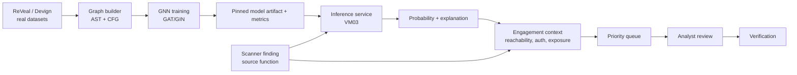

# SENTRIX — GNN direction proposal

| Field | Value |
|---|---|
| Document ID | `SENTRIX-GNN-PROP-001` |
| Date | 2026-10-26 |
| Status | Proposal — direction decision pending |
| Scope | Local authorized pentest demo |

## 1. Position statement

Do **not** call this an “AI pentest model”. A GNN over source code does not
perform reconnaissance, exploitation, or lateral movement. The defensible
position is:

> **GNN-assisted vulnerability triage for an authorized pentest workflow.**

The scanner finds candidate vulnerabilities; the GNN estimates whether a
function is vulnerable and helps rank what the analyst should verify first. The
human still owns scope, exploitation, and remediation.

This distinction is important academically: it keeps the claim measurable and
avoids overstating what the model does.

## 2. Recommended direction

**Dataset:** ReVeal (real-world C/C++ function-level vulnerable/clean labels),
with Devign as an external generalization set.

**Task:** binary function-level vulnerability classification.

**Graph:** AST + CFG edges, optionally CPG (AST + CFG + PDG) as an ablation.

**Model:** GAT or GIN with class-imbalance handling; compare against GCN and a
sequence/MLP baseline.

**Pentest integration:** a finding that carries a source function is enriched
with:

- vulnerability probability;
- calibrated confidence;
- reachability from an entry point;
- auth/exposure context from the engagement;
- a short explanation subgraph.

The output is a **priority score**, not an automatic exploit decision.

## 3. Why this is logical for pentest

Real pentest triage is not “find every issue”; it is deciding:

1. Which findings are real?
2. Which are reachable from an untrusted entry point?
3. Which cross an authorization boundary?
4. Which should be verified first?

GNNs fit because vulnerabilities are relational: a sink is dangerous because of
the path that reaches it, not because of a single token. A graph model can learn
patterns over data flow, control flow and API use that a bag-of-tokens model
misses.

The pentest workflow then becomes:

```text
scope + authorization
      ↓
scanner / SAST finding
      ↓
function graph + engagement context
      ↓
GNN vulnerability score
      ↓
reachability-aware priority
      ↓
analyst verification / exploitation
      ↓
remediation + verification
```

## 4. Creative contribution

The novelty should not be “I used a GNN”. That is not enough. The contribution
should be a small, testable combination:

### C1. Reachability-aware triage

Combine:

```text
p_vuln(function) × reachability(entry → function) × exposure/auth context
```

and evaluate `precision@k` / `recall@k` against raw GNN probability. This is
closer to what a pentester needs than plain F1.

### C2. Cross-dataset generalization

Train on ReVeal, test on Devign (and the reverse), with project/time splits.
Report the degradation honestly. This is stronger than a single random split.

### C3. Explanation as evidence

Use GNNExplainer or attention weights to return a small subgraph:

```text
source → sink path
relevant AST/CFG nodes
controlling branch / sanitizer
```

The explanation is attached to the finding as analyst-facing evidence, not as
proof.

### C4. Human-in-the-loop contract

The model may:

- rank findings;
- suggest likely vulnerable functions;
- show a subgraph.

The model may not:

- mark a finding verified;
- resolve a finding;
- launch exploitation;
- contact a target.

This aligns with the existing SENTRIX rule: verification resolves a finding.

## 5. Architecture



### Integration boundary

Implement a new `InferencePort` adapter:

```text
MockInferenceAdapter  → development
GnnInferenceAdapter   → real model
```

The API stores:

```text
analysis.model_version_id
analysis.confidence
analysis.summary
analysis.limitations
analysis.simulated = false
```

The model artifact, dataset hash, seed and environment are recorded in
`evaluation_run`.

## 6. Experiments and claims

| ID | Hypothesis | Metric |
|---|---|---|
| H1 | GAT/GIN beats GCN and sequence baseline | PR-AUC, F1 |
| H2 | AST+CFG beats AST-only | PR-AUC |
| H3 | Cross-dataset transfer degrades but remains useful | delta PR-AUC |
| H4 | Reachability-aware priority beats raw probability | precision@10/50 |
| H5 | Explanation subgraph is useful to analysts | small expert review / rubric |
| H6 | Integration adds acceptable latency | p50/p95 latency |

Controls:

- project-level or time-based split, never random function split;
- deduplicate near-identical functions;
- report class balance and confidence intervals;
- fixed seeds and environment;
- no test-set tuning;
- dataset licence and hash recorded.

## 7. Honest limitations

- **White-box only.** A code GNN cannot score a black-box web target without
  source. For black-box work, use scanner/DAST findings and do not fake a GNN
  score.
- **Dataset bias.** ReVeal/Devign are C/C++ and not representative of every
  language or business logic.
- **Labels are noisy.** A “clean” function may still be vulnerable in context.
- **Graph construction cost.** Full CPG via Joern is heavy; AST+CFG is the
  pragmatic baseline.
- **No exploit prediction.** Vulnerability probability is not exploitability.
- **No production claim.** This remains a local research prototype.

## 8. Alternative directions

| Direction | Pentest fit | Feasibility | Risk |
|---|---|---|---|
| Code GNN on ReVeal + triage | medium-high | high | dataset/graph work |
| Network GNN on CICIDS flow graphs | medium | medium | not function-level pentest |
| Attack-graph GNN on engagement data | high | low | no real labelled dataset |
| LLM + GNN hybrid | high | low-medium | cost, evaluation, prompt leakage |

Recommendation: **Code GNN + reachability-aware triage**. It is feasible,
measurable, and genuinely useful to a pentester, without inventing a dataset.

## 9. Roadmap

1. Dataset audit: licence, hash, split, label distribution.
2. Build graph builder; freeze graph schema.
3. Train baselines: MLP/sequence → GCN → GAT/GIN.
4. Run ablations and cross-dataset test.
5. Add explanation output.
6. Add `GnnInferenceAdapter` + VM03 HTTP service.
7. Integrate priority into SENTRIX finding triage.
8. Record X-03/X-04, reproducibility log and governance.

## 10. Defense framing

> “SENTRIX uses a graph neural network as a triage aid: it estimates
> function-level vulnerability likelihood from real-world code graphs and ranks
> findings for analyst verification. It does not autonomously exploit targets;
> verification and remediation remain human actions. The evaluation reports
> cross-dataset generalization, reachability-aware ranking, and explanation
> quality, with dataset hashes and fixed seeds.”

This is a stronger and more honest claim than “AI pentest”.
