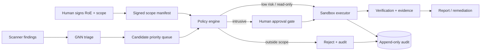

# SENTRIX — Automation boundaries for scope, authorization, verification and exploitation

| Field | Value |
|---|---|
| Document ID | `SENTRIX-AUTO-BOUND-001` |
| Date | 2026-10-26 |
| Scope | Isolated local lab only |
| Status | Design guidance |

## 1. Short answer

Technically, a local lab pipeline can automate most of:

- scope enforcement;
- evidence verification;
- bounded exploitation/PoC execution.

But **authorization cannot be automated by the system**. Authorization is a
human/legal act. Software can only:

- record who authorized what;
- enforce the signed scope;
- refuse actions outside it.

So the correct target is **supervised automation**, not full autonomy:

```text
human authorizes
   ↓
system enforces + plans + executes bounded actions
   ↓
human reviews high-impact results
```

Full autonomy for exploitation is not recommended, even in a lab, because a
model false positive can still cause destructive or misleading actions.

## 2. Automation levels

| Level | Scope | Authorization | Verification | Exploitation | Recommendation |
|---|---|---|---|---|---|
| L0 manual | human | human | human | human | baseline |
| L1 assisted | parsed/validated | human | suggested | suggested | safe |
| L2 supervised | enforced | human-signed | automated + human final | approved action library | **recommended** |
| L3 conditional | enforced | human-signed | automated | auto within narrow allowlist | research only |
| L4 full | auto | self-granted | auto | auto | **reject** |

L4 is rejected because “self-granted authorization” is not authorization.

## 3. What can be automated safely

### 3.1 Scope

Automate enforcement:

- signed scope manifest: domains, CIDRs, ports, paths, time window;
- explicit exclusions;
- target allowlist checked on every action;
- DNS resolution pinned to approved IPs;
- redirect/SSRF guards;
- request budget, rate limit, concurrency cap;
- destructive-method deny list;
- kill switch.

Do not automate scope *creation*. A human defines and signs it.

### 3.2 Authorization

Automate verification of an existing authorization:

- signed RoE/authorization artifact;
- engagement ID, owner, validity window, scope hash;
- target ownership attestation;
- immutable audit of who approved each intrusive action.

The system must never mark a target as authorized just because it is reachable.

### 3.3 Verification

Automate:

- reproducible check for a finding;
- evidence capture and SHA-256;
- before/after state comparison;
- re-run with fixed inputs;
- policy checks (is the result within scope?);
- confidence/explanation from the GNN.

Human final approval remains for high/critical or state-changing findings.

### 3.4 Exploitation

This is the highest-risk part. If it is automated at all, constrain it to an
isolated lab:

- VM05 only, no NAT/default route;
- snapshot/rollback before each run;
- no persistence, evasion, credential theft, or data exfiltration;
- bounded action library, no arbitrary payloads;
- allowlisted target and port;
- time/attempt limit;
- human approval for any state-changing action;
- kill switch and full audit.

The output should be a **PoC result**, not a weaponized exploit.

## 4. Where the GNN fits

The GNN is a **ranking aid**, not an authority.

```text
scanner findings
     ↓
GNN vulnerability probability + explanation
     ↓
priority queue
     ↓
policy engine: scope + auth + risk + action budget
     ↓
approval gate (human for intrusive actions)
     ↓
sandbox execution
     ↓
verification + evidence
```

The GNN can:

- rank functions/findings;
- suggest reachable candidates;
- provide an explanation subgraph.

The GNN cannot:

- grant authorization;
- modify scope;
- verify or resolve a finding by itself;
- trigger exploitation without policy/human approval.

If the model is uncertain, it must **abstain** and fall back to analyst review.

## 5. Recommended architecture



## 6. Hard controls

- Default deny: no scope entry, no action.
- Signed scope hash checked by every executor.
- Authorization expiry and revocation.
- One action = one audit record.
- No raw credentials in logs.
- Evidence hash before/after.
- Snapshot/rollback for lab targets.
- Kill switch at orchestrator and executor.
- Model version, prompt/version, dataset hash pinned.
- Never expose the orchestrator outside the lab network.

## 7. Thesis framing

A defensible claim:

> SENTRIX automates scope enforcement, evidence capture and bounded PoC
> verification under a human-signed authorization. A GNN ranks candidate
> findings, but does not grant authorization, resolve findings, or exploit
> targets autonomously. Intrusive actions require an explicit approval gate and
> run only against an isolated lab VM with snapshot rollback.

This is stronger than “fully automated pentest” because it shows:

- safety engineering;
- policy enforcement;
- measurable human-in-the-loop evaluation;
- honest limitations.

## 8. Recommendation

Build **L2 supervised automation**:

1. signed scope manifest + policy engine;
2. GNN triage + explanation;
3. read-only checks auto-run;
4. intrusive actions require approval;
5. verification auto-captures evidence, human finalizes;
6. snapshot/rollback on VM05;
7. full audit and kill switch.

Do not build L4. It is not credible as “authorized pentest” and is unsafe even
in a demo.
