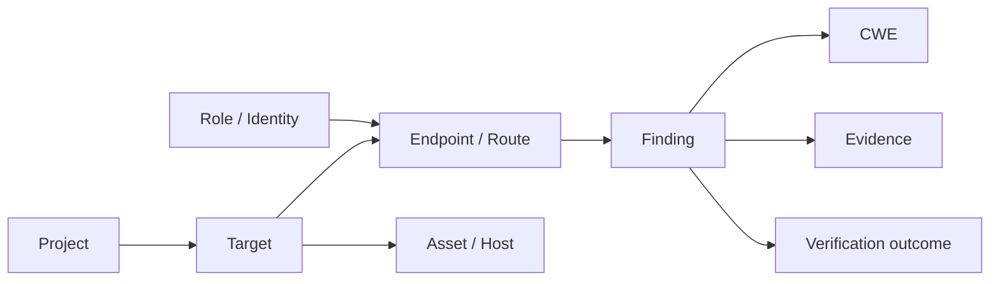

# SENTRIX — GNN redesign for the web/API scope

| Field | Value |
|---|---|
| Document ID | `SENTRIX-GNN-REDESIGN-001` |
| Date | 2026-10-26 |
| Decision | Replace the C-code GNN with a web/API attack-graph GNN for the core; keep Devign as a separate white-box experiment |
| Status | Proposal |

## 1. The actual problem

The current GNN is a **C/C++ function-level vulnerability classifier** trained
on Devign. SENTRIX's core is a **web/API pentest workflow**. These are different
objects:

```text
Devign:    C function → vulnerable/clean
SENTRIX:   project → target → endpoint → finding → evidence → verification
```

A Devign score cannot be assigned to an API finding without inventing a source
mapping. That is why import into `automation_candidate` is blocked.

The model is not "broken"; it is answering the wrong question for this project.

## 2. Options

| Option | What it means | Fit | Risk |
|---|---|---|---|
| A. Keep Devign separate | C-code GNN as an appendix/white-box experiment | honest | low |
| B. Web/API attack-graph GNN | model SENTRIX's own graph | high | medium |
| C. Drop GNN | use calibrated tabular baseline | high | low, less novelty |

Recommendation: **B as the core**, **A as an appendix**, never mix A scores into
the web workflow.

## 3. Recommended graph schema

Heterogeneous graph:



Node features:

- endpoint: method, auth required, role, path depth, parameter count;
- finding: severity, confidence, CWE, source (`DAST`/`SAST`);
- target: type, scope, exposure;
- role: privilege level;
- evidence: hash/length, not raw secrets.

Edges:

- target → endpoint (exposure);
- role → endpoint (authorization boundary);
- finding → endpoint (location);
- finding → CWE (weakness class);
- finding → verification (outcome);
- endpoint → endpoint (call/redirect relationship, if available).

## 4. Task

Start with one task:

> **Exploitable finding prediction**: given a finding node and its graph
> context, predict whether the finding is verified exploitable in this lab.

Later:

- attack-path link prediction;
- priority score for analyst triage.

Do not start with “find all vulnerabilities”; too broad.

## 5. Labels

Use **real local outcomes**, not synthetic labels:

- verified vs false positive from pentest runs;
- remediation verification outcome;
- Juice Shop challenge success as an additional signal.

20 findings is small. Therefore:

- use temporal/engagement split, not random;
- report confidence intervals;
- compare against a severity heuristic baseline;
- if GNN does not beat the baseline, report that honestly.

## 6. Model

Use a heterogeneous GNN:

```text
R-GCN / HGT / GraphSAGE with relation-aware message passing
```

Not the Devign GAT. The graph schema and task are different.

Output:

```text
exploitableProbability + explanation subgraph
```

## 7. Integration

```text
finding + endpoint context
      ↓
web graph builder
      ↓
GNN score
      ↓
automation_candidate.score
      ↓
policy queue
```

The GNN only ranks. It cannot verify, resolve, or authorize.

## 8. What to fix now

1. Rename the Devign artifact:
   `gnn-devign-c` — explicitly C-code, not SENTRIX web.
2. Quarantine it from web scoring.
3. Add structured fields to findings:
   - `cwe`
   - `location` JSON (url/file/function/resource)
   - `verificationOutcome`
   - `source` (`DAST`/`SAST`/`MANUAL`)
4. Build a **graph collector** from:
   - project/target/finding/evidence/verification tables;
   - API routes and auth metadata;
   - DAST/scan results.
5. Collect 20 verified findings in the lab.
6. Train:
   - baseline: severity + CVSS + heuristic;
   - GNN: R-GCN/HGT.
7. Evaluate precision@k/PR-AUC and calibration.
8. Only then import scores into the queue.

## 9. Evaluation

| Metric | Why |
|---|---|
| PR-AUC | class imbalance |
| precision@10/20 | triage value |
| recall@20 | coverage |
| calibration (ECE) | confidence honesty |
| comparison to severity heuristic | does GNN add value? |
| explanation plausibility | analyst trust |

A negative result is acceptable: “GNN did not beat the heuristic on 20 local
findings” is more credible than a fabricated improvement.

## 10. Thesis framing

> “SENTRIX uses a heterogeneous attack-graph GNN to rank API findings for
> analyst verification. The graph encodes target, endpoint, role, finding, CWE
> and verification context. The model is evaluated against a severity baseline
> on a local 20-finding corpus. A separate Devign C-code experiment is reported
> as an appendix and is not used to score web findings.”

This is coherent:

- web/API core;
- GNN on the project’s own graph;
- no cross-domain score fabrication;
- negative results allowed.

## 11. What not to do

- Do not attach Devign scores to web findings.
- Do not call the Devign model “SENTRIX web AI”.
- Do not train a GNN on 3 seed findings and call it validation.
- Do not let GNN output bypass verification.

## 12. Implementation progress

Done:

- `finding.cwe` and structured `finding.location` added (`006_finding_context.sql`);
- graph collector `backend/training/web_graph/collect.py`;
- bootstrap exposes `cwe` and `location`;
- non-destructive 20-probe harness `backend/training/web_graph/harness.py`;
- dataset builder `backend/training/web_graph/build_dataset.py`;
- severity baseline `backend/training/web_graph/baseline.py`;
- backend suite still **59 passed**.

Current corpus:

```json
{
  "findings": 20,
  "verified": 5,
  "false_positive_candidates": 15
}
```

Baseline:

```text
precision@5  = 0.20
precision@10 = 0.20
precision@20 = 0.25
recall@20    = 1.00
```

The labels are **harness-rule labels**, not human pentest labels.

Blocked:

- R-GCN/HGT training — only 5 positives is too small;
- score import;
- L2/L3 on real findings beyond policy simulation.

Training now would overfit 20 records and produce a meaningless metric.


