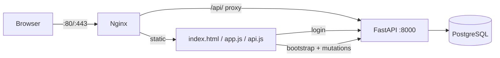

# SENTRIX frontend

API-backed local UI for the SENTRIX demo.

## Contents

| Path | Purpose |
|---|---|
| `index.html` | SPA shell |
| `login.html` | local token login |
| `app.js` | views, modals, event handlers |
| `api.js` | API adapter; optimistic mutations and auth headers |
| `domain.js` | in-memory repository (fallback/demo) |
| `styles.css` | UI styles |
| `server.mjs` | loopback static dev server |
| `static.js` | static path policy |
| `tests/` | Node unit/HTTP tests |
| `scripts/` | browser checks and UI smoke |
| `public/assets/` | local SVG mark |

## Run

```bash
npm install        # no dependencies are required at runtime
npm run dev        # http://127.0.0.1:3000
```

`server.mjs` binds loopback by default. The deployed copy is served by Nginx
from `/var/www/sentrix`.

## Authentication

1. `login.html` posts to `/api/v1/auth/login`.
2. The bearer token is stored in `localStorage`.
3. `api.js` sends `Authorization: Bearer ...` on API calls.
4. A 401 redirects to `/login.html`.

Local demo accounts:

```text
maya@sentrix.local / sentrix-demo   # ANALYST
admin@sentrix.local / admin-demo    # ADMIN
```

## Test

```bash
npm test
npm run test:one                    # if the sandbox blocks child-process spawning
node scripts/ui-smoke.mjs           # deployed UI; requires network access
node scripts/browser-api-check.mjs  # API-mode parity; requires deployed API
```

`browser-check.mjs` runs the 13 in-memory browser checks with
`?repo=memory`; `browser-api-check.mjs` runs 14 API-mode checks (login,
bootstrap, all views, CSV export, reload persistence, no off-origin requests).

`npm test` uses Node's built-in test runner and the local static server.
`ui-smoke.mjs` logs in and checks all views against the deployed UI.

## Deployed flow



## Known limits

- M5-01…M5-06 repository selection, `/transitions`, scan polling, verification
  parity, CSV export, and browser parity are implemented; M5 governance remains.
- Optimistic updates are reconciled only in the browser session; a reload
  refreshes from the API.
- Artifact upload/download is available from the finding detail modal.
- The demo UI is read/write for local authorized users only.
